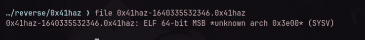
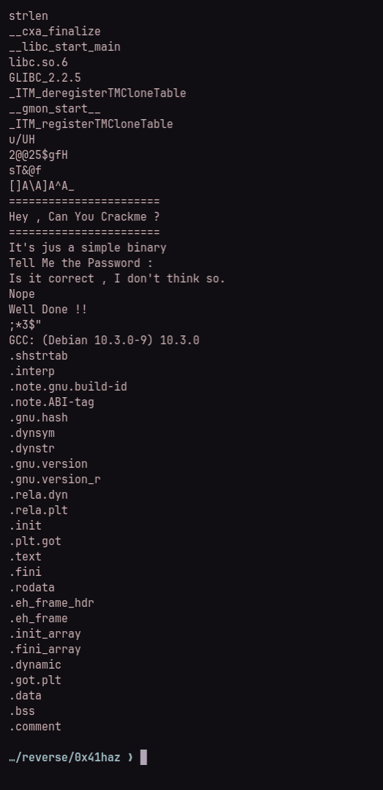
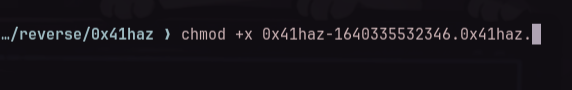
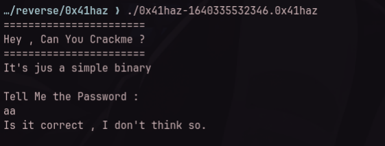
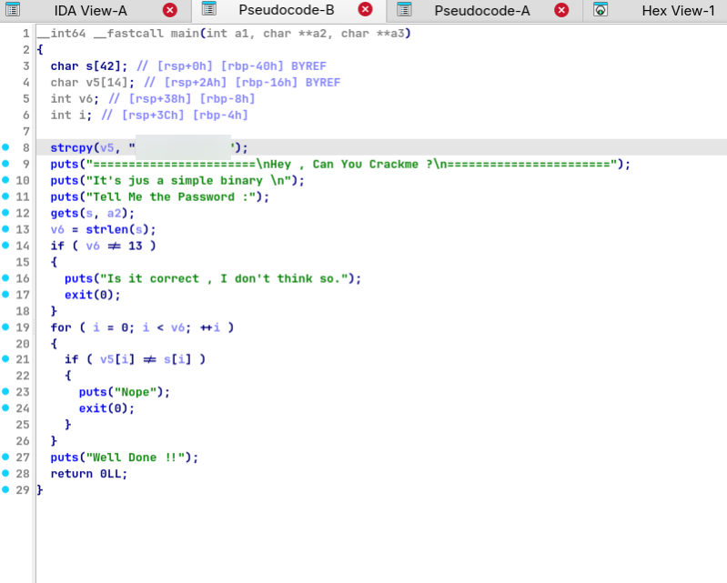
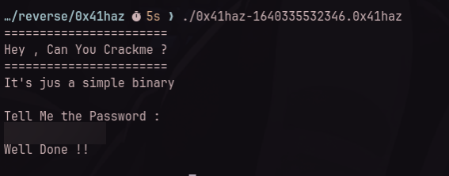

# TryHackMe — 0x41haz

**Room:** https://tryhackme.com/room/0x41haz
**Category:** Reverse Engineering
**Difficulty:** Easy
**Date:** 2026-11-05
**Tools:** `file`, `strings`, IDA Pro
**Binary:** 64-bit ELF — not redistributed (TryHackMe content)

## TL;DR

A one-task crackme: the program asks for a password and the expected value is
copied into a local variable with `strcpy()` before the check, so it can be read
straight out of the decompiled `main`. Entering it validates the password, which
serves as the flag content.

## Recon

`file` identifies the target as a 64-bit ELF with a corrupted endianness byte in the header (`MSB *unknown arch 0x3e00*`), which needs to be patched back to LSB (`0x01` at offset `0x05`) before running on x86-64:



`strings` mostly surfaces the banner the program prints:



The downloaded binary had no execute permission, so I set it before running:

```bash
chmod +x 0x41haz-1640335532346.0x41haz
```



Running it asks for a password, and a wrong input (`aa`) is rejected with
"Is it correct , I don't think so.":



## Task 1 — Find the flag

**Question:** What is the flag? (the program asks for a password that acts as the flag)

**Observation**

Opening `main` in IDA shows the whole program at once. The expected password is
copied into `v5` as a plain string literal:

```c
strcpy(v5, "<password — 13 characters>");
```

(The literal is redacted here; it is 13 printable characters, which matches the
length check below.)

Then come the banner and the input:

```c
puts("=======================\nHey , Can You Crackme ?\n=======================");
puts("It's jus a simple binary \n");
puts("Tell Me the Password :");

gets(s, a2);
```

After that the input is validated in two stages — first the length, then a
character-by-character comparison against `v5`:

```c
v6 = strlen(s);
if ( v6 != 13 )
{
    puts("Is it correct , I don't think so.");
    exit(0);
}

for ( i = 0; i < v6; ++i )
{
    if ( v5[i] != s[i] )
    {
        puts("Nope");
        exit(0);
    }
}

puts("Well Done !!");
```



**Reasoning**

The comparison is plaintext — no hashing, no encoding — so the constant handed
to `strcpy()` *is* the password. The length check even tells us how long it is
(13 characters), and the loop only confirms what `strcpy` already revealed. The
fastest path is therefore to read the literal, not to brute force anything.

**How:** run the binary and enter that 13-character string

```bash
./0x41haz-1640335532346.0x41haz
# password: <redacted>
```

**Result:** the program replies "Well Done !!", confirming the password to wrap in `THM{...}`.



**Answer:** `THM{redacted}`

## Takeaways

- **Hardcoded comparisons are readable.** When the expected value is a literal
  inside `main`, the binary hands you the answer.
- **The order of the checks is a hint.** The `strlen(...) != 13` check leaks the
  password length before the comparison loop even runs.
- **Read the pseudo-code top-down.** `strcpy` → banner → input → length check →
  character loop is the entire program; naming each step makes the flag obvious.
- **`strings` is always worth a try.** Here it only produced the banner (since short `strcpy` literals are often compiled as immediate stack moves), but in other binaries the same constant can show up there directly.

## References

- Room: https://tryhackme.com/room/0x41haz