# TryHackMe — Reverse Files

**Room:** https://tryhackme.com/room/reverselfiles
**Category:** Reverse Engineering
**Difficulty:** Easy
**Date:** 2026-11-04
**Tools:** `chmod`, IDA Pro, gdb, `ltrace`, `base64`
**Binaries:** 64-bit ELF — not redistributed (TryHackMe content)

## TL;DR

A set of eight small crackmes that walk through the basics of reverse
engineering: identifying what a binary does, reading decompiled pseudo-code,
cross-checking it against the real assembly, and using dynamic tools (`gdb`,
`ltrace`) when static reading is not enough. The hardest part was matching the
assembly with the pseudo-code instead of trusting the decompiler blindly.

## Objective

Practise decompilation and dynamic analysis, and learn to read assembly to
confirm what the decompiler shows. After this room I can navigate a stripped-down
binary, find the comparison that guards the flag, and inspect it at runtime.

## Task 1 — crackme1

**Question:** How do you run the program?

**How:**

```bash
chmod +x crackme1
```

The file did not have the execute bit set, so the shell refused to run it.
`chmod +x` adds it.

**Result:** the binary runs.

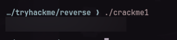

**Answer:** `THM{redacted}`

## Task 2 — crackme2

**Question:** What is the password that makes the program print the flag?

**Observation**

I loaded the binary into IDA and decompiled `main`. The password is visible
right there, compared against the user input.

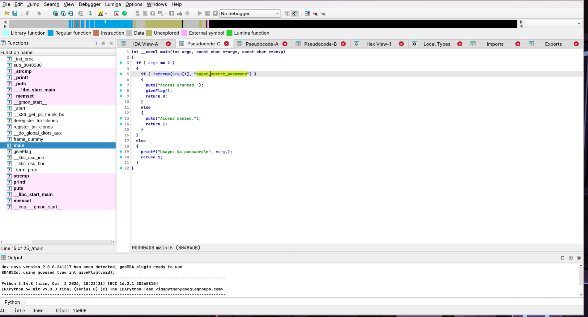

**Reasoning**

IDA translates machine code into pseudo-code, so a simple string comparison
inside `main` costs nothing to find — no need to run the binary at all.

**How:**

```bash
./crackme2 <password>    # or paste it at the prompt
```

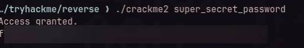

**Answer:** `THM{redacted}`

## Task 3 — crackme3

**Question:** What is the flag?

**Observation**

Inside `main` there is a long, suspicious Base64-looking string. It is not a
plain flag, so it is probably obfuscated rather than encrypted.

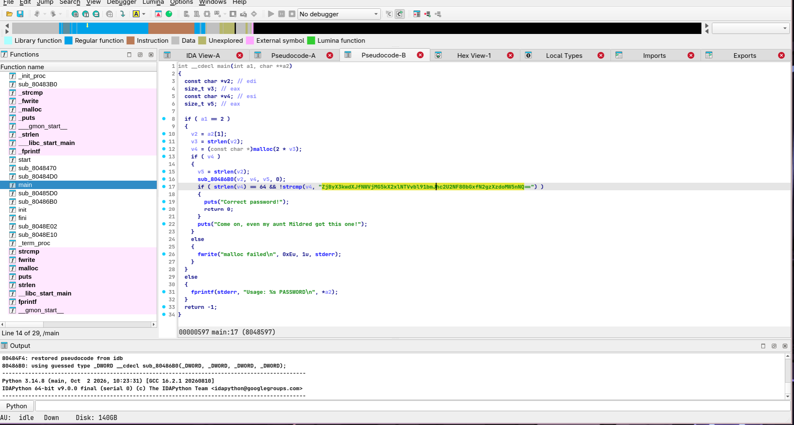

**Reasoning**

A Base64 blob in a crackme usually means "decode me". It is reversible, and
decoding is a one-liner.

**How:**

```bash
echo '<base64 string>' | base64 -d
```

The encoded string is left out here so the answer stays redacted; decoding it
prints the flag directly.

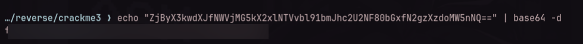

**Answer:** `THM{redacted}`

## Task 4 — crackme4

**Question:** What is the flag?

**Observation**

I wanted to watch the comparison happen instead of reading the whole binary
statically, so I used gdb.

**How:**

```bash
$ gdb ./crackme4
(gdb) info functions      # list the functions in the binary
(gdb) disas main          # see which functions main calls
(gdb) disas compare_pwd   # inspect the comparison routine
```

`main` calls `compare_pwd`, and `compare_pwd` calls `strcmp`:

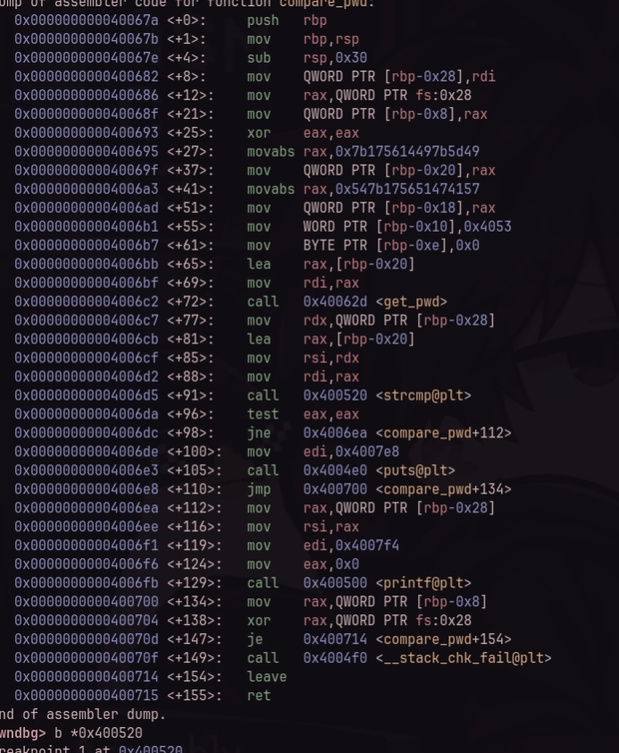

So I put a breakpoint on `strcmp` and gave it dummy input:

```bash
(gdb) break strcmp
(gdb) run test
(gdb) info registers
```

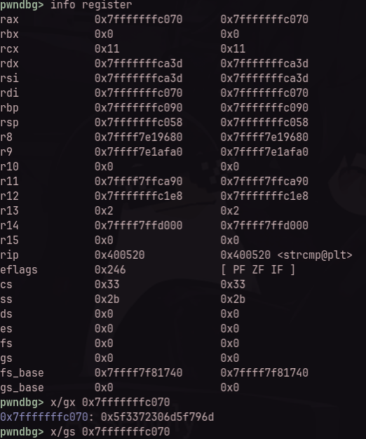

**Reasoning**

At the `strcmp` breakpoint, one argument holds my input and the other holds the
real password. On x86-64 those pointers are in `rdi` and `rsi`, so reading the
string at the address in the second register reveals the expected password.

```bash
(gdb) x/s $rdi     # my input
(gdb) x/s $rsi     # the expected password
```

**Result:** the string shown is the password; running the binary with it prints
the flag.

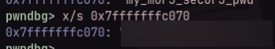

**Answer:** `THM{redacted}`

## Task 5 — crackme5

**Question:** What is the hidden string?

**Observation**

The hidden string is used inside `main`: the program compares it against the
input, so it is not buried in a helper function.

**Reasoning**

That gives two independent ways to recover it:

- **Static** — decompile `main` in IDA; the expected string is right there
  next to the comparison.
- **Dynamic** — run the program under `ltrace` and let it log the library
  calls; the string appears among the `strcmp`/`printf` arguments.

I did both, so the static reading is confirmed by the runtime trace.

**How:**

```bash
ltrace ./crackme5
# input: xx
```

**Result:** the trace contains the same string IDA showed in `main`.

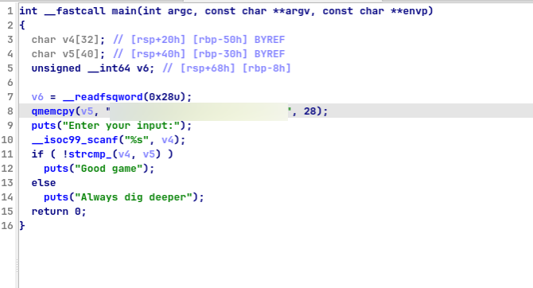

**Answer:** `THM{redacted}`

## Task 6 — crackme6

**Question:** What is the password?

**Observation**

Inside IDA, the function `my_secure_test` contains eight character comparisons against the input.

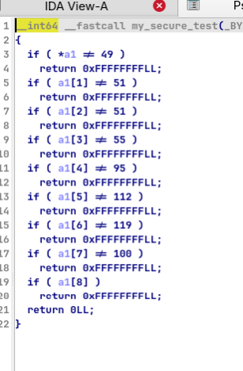

**Reasoning**

Typing those values literally fails because the checks are against decimal character codes (`49, 51, 51, 55, 95, 112, 119, 100`) rather than printable characters. Each value represents the ASCII code of one character in the password.

We can press `R` in IDA to toggle the numeric constants directly into character literals, or decode them with Python:

```bash
python3 -c "print(''.join(chr(int(x)) for x in '49 51 51 55 95 112 119 100'.split()))"
# Output: 1337_pwd
```

**Result:** supplying `1337_pwd` satisfies `my_secure_test` and prints the flag.

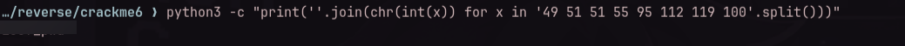

**Answer:** `THM{redacted}`

## Task 7 — crackme7

**Question:** What is the flag?

**Observation**

The program offers three visible menu options (`[1] Say hello`, `[2] Add numbers`, `[3] Quit`). However, inspecting `main` in IDA reveals a hidden fourth branch:

```c
else if ( v7[0] == 31337 )
{
  puts("Wow such héxer!");
  giveFlag();
}
```

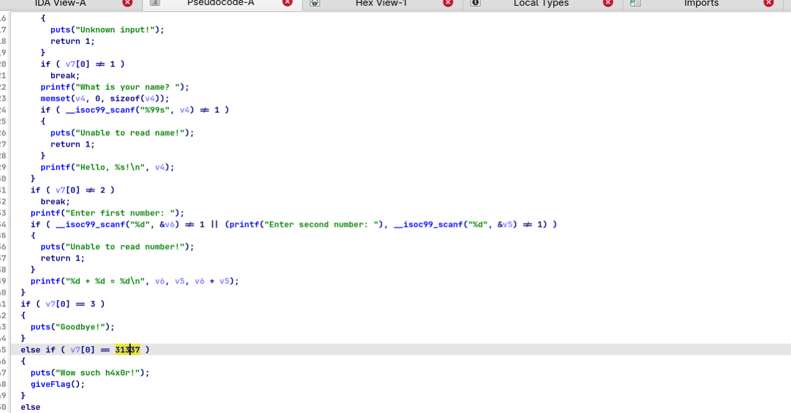

**How:** run the program and enter the hidden option `31337`.

```bash
./crackme7
# choice: 31337
```

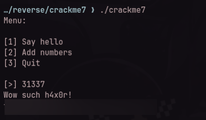

**Answer:** `THM{redacted}`

## Task 8 — crackme8

**Question:** What is the flag?

**Observation**

In `main`, the program takes `argv[1]`, converts it with `atoi()`, and checks if it matches a hardcoded constant to call `giveFlag()`:

```c
if ( atoi(argv[1]) == -889262067 )
```

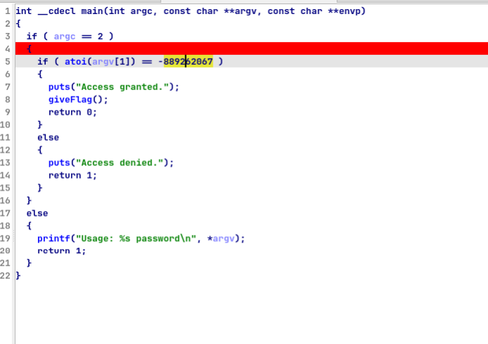

**Reasoning**

In assembly, the comparison value is the hexadecimal constant `0xcafef00d`. Because `atoi()` expects a decimal string and returns a signed 32-bit integer, we must convert `0xcafef00d` (which has its most significant bit set) from hexadecimal to its signed 32-bit decimal equivalent:

- Hexadecimal: `0xcafef00d`
- Signed 32-bit Decimal: `-889262067`

**How:** run the binary passing the signed decimal value as the argument.

```bash
./crackme8 -889262067
```

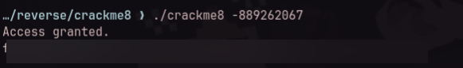

**Answer:** `THM{redacted}`

## What I'd do differently

Honestly, not much — this room is deliberately easy. Every task gave way to a
single tool (IDA, gdb, or `ltrace`), and I never had to abandon an approach or
backtrack on a wrong guess.

## Takeaways

- **Pseudo-code is a hint, not the truth.** In Task 4 the decompiler was right,
  but only the assembly showed exactly which register held the compared string.
- **Static first, dynamic when stuck.** IDA solves the trivial crackmes in
  seconds; gdb/`ltrace` are for when the logic is indirect.
- **Look for the guard.** Every crackme has a comparison that decides
  success/failure — find it, then decide whether to read it or break on it.
- **Obfuscation is not encryption.** A Base64 blob is a decode away; always try
  `strings`, `base64 -d`, and simple XOR before assuming something harder.
- **Signed vs unsigned integer representation.** In crackme8, `atoi()` parses
  signed decimals while decompilers and assembly often show hex (`0xcafef00d`),
  requiring signed 32-bit integer conversion.

## References

- Room: https://tryhackme.com/room/reverselfiles
